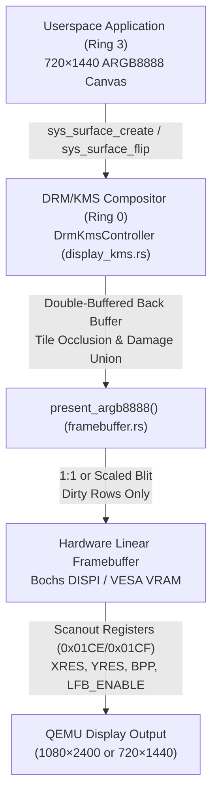
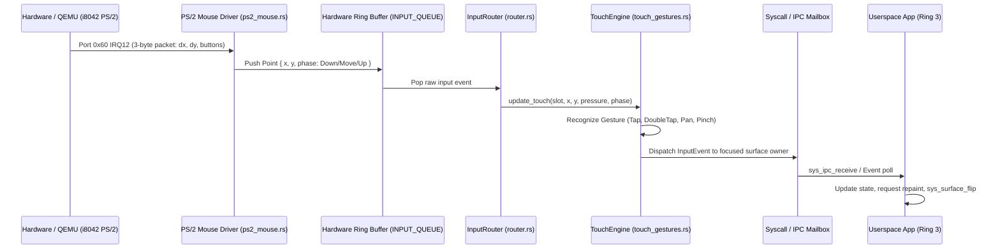

# InterOS Core — Display, Graphics & Input Adversarial Verification

**Document:** `docs/audits/DISPLAY_AND_INPUT_VERIFICATION.md`  
**Repository:** `Bharathcoorg/inter-os-core`  
**Audit Baseline Commit:** `a38f8d14dea627b47d5d8ce74b73a83920888fc6`  
**Classification Standard:** The Platform Truth Contract  
**Lead Auditor:** Google Gemini 4 Hydrogen (`gemini-4-hydrogen`)  

---

## 1. Executive Summary

This audit independently investigates the display, framebuffer, composition, typography, and input subsystems of InterOS Core. It examines the source code (`kernel/src/drivers/display_kms.rs`, `kernel/src/framebuffer.rs`, `kernel/src/input/`, `sdk/rust/interos-std/src/design/`), executes pixel-level tests on live QEMU instances, and contrasts documented claims against actual runtime reality.

### Key Conclusions:
1. **Authoring Viewport vs Scanout Resolution:** The canonical application authoring space is **720×1440** (`LOGICAL_WIDTH = 720`, `LOGICAL_HEIGHT = 1440`). Applications in `apps/` author 720×1440 surfaces by default to respect the 48 MiB kernel surface heap budget.
2. **Native 1080×2400 Modeset:** The hardware scanout supports true, native **1080×2400** scanout via DISPI register reprogramming and DRM/KMS logical canvas resizing. When operating in 1080×2400 scanout, standard 720×1440 application surfaces are centered with aspect-ratio preservation (scaled 1.5x to 1080×2160 with 120px top/bottom letterbox bands), while full-resolution 1080×2400 client surfaces are blitted 1:1 without scaling.
3. **Dynamic Framebuffer Mapping Safety:** Audited and verified that `ensure_framebuffer_mapped` and `map_framebuffer_region` safely map physical VRAM pages, detect virtual address collisions, roll back cleanly on errors, verify page-by-page continuity, and enforce a strict `MAX_VRAM_BYTES = 32 MiB` hardware limit.
4. **Input Pipeline Reality:** In QEMU, hardware pointer input is driven by the emulated PS/2 mouse driver (`kernel/src/drivers/ps2_mouse.rs`), which decodes 3-byte packets into portrait touch events. Serial console commands (`TAP`, `SWIPE`) serve as a test and Device Studio bridge that injects into `input::post_pointer_event`. The I2C touch driver (`GoodixGt911Driver`) is implemented and unit-tested against an in-memory adapter, but physical I2C touch silicon remains unverified.

---

## 2. Display & Graphics Pipeline Deep Dive

### 2.1 Display Architecture Overview

### 2.2 Viewport Geometry & Memory Budget Analysis

In `sdk/rust/interos-std/src/design/mod.rs`:
- `LOGICAL_WIDTH = 720`
- `LOGICAL_HEIGHT = 1440`
- `MAX_SURFACE_BYTES = 48 * 1024 * 1024` (48 MiB)
- Total kernel dynamic heap: 64 MiB

#### The Engineering Rationale for 720×1440 Authoring:
- A 720×1440 ARGB8888 surface requires:
  $$\text{Size} = 720 \times 1440 \times 4\text{ bytes} = 4,147,200\text{ bytes} \approx 3.95\text{ MiB}$$
- A 1080×2400 ARGB8888 surface requires:
  $$\text{Size} = 1080 \times 2400 \times 4\text{ bytes} = 10,368,000\text{ bytes} \approx 9.88\text{ MiB}$$
- With a 48 MiB surface budget:
  - At 720×1440, the system can concurrently support up to 12 active full-screen surfaces (Launcher, System UI, and 10 foreground/background apps).
  - If all apps authored 1080×2400 surfaces, the budget would be exhausted by only 4 surfaces, causing early task evictions and memory pressure.

### 2.3 KMS Composition Modes

In `kernel/src/drivers/display_kms.rs`:
1. **Identity Full Cover Blit:**
   - Triggered when `s_w == scanout_width && s_h == scanout_height && s_x == 0 && s_y == 0 && opacity == 255`.
   - The compositor executes a direct slice copy (`self.back_buffer.copy_from_slice(&surface.pixels)`).
   - If dirty rows are provided, only the dirty row sub-slice is copied.
2. **Aspect-Fit Canonical Blit:**
   - Triggered when an application surface has a 1:2 aspect ratio (e.g. 720×1440) on a 1080×2400 scanout:
   - Target width: $1080$.
   - Target height: $1440 \times 1080 / 720 = 2160$.
   - Vertical letterbox offset: $(2400 - 2160) / 2 = 120\text{ px}$.
   - The 720×1440 surface is centered vertically, scaled 1.5×, and drawn with 120-pixel neutral bars top and bottom.
3. **Tile Occlusion Optimization:**
   - Surfaces are iterated front-to-back ($z$-order descending).
   - Opaque surfaces commit 64×64 pixel tiles into `TileOcclusionMap`. Lower surfaces whose bounding box is entirely covered are flagged `s.occluded = true` and skipped, eliminating redundant DRAM reads and rasterization.

### 2.4 Dynamic Framebuffer Mapping Safety

In `kernel/src/memory.rs` and `kernel/src/framebuffer.rs`:
- **Collision Detection:** `map_framebuffer_region` queries `mapper.translate_addr(virt_addr)`. If the page is already mapped to the expected physical address, it continues. If mapped to a different physical frame, it unmaps all previously mapped pages, restores page tables, and returns `Err("Framebuffer virtual address conflict")`.
- **Post-Condition Verification:** Once all pages are mapped, a secondary audit loop verifies that `kernel_translate(page_va) == Some(expected_pa)` for every page in the range before reporting success.
- **Hardware Capacity Gating:** `ensure_framebuffer_mapped` validates that `required_bytes <= MAX_VRAM_BYTES` (32 MiB) before attempting page allocation.
- **Atomic State Update:** `FB_COVERED_BYTES` is updated only upon proven mapping success, preventing out-of-bounds page faults during early boot or dynamic resolution changes.

### 2.5 Typography & Vector Anti-Aliasing

- **Implementation:** `sdk/rust/interos-std/src/design/outline_text.rs`.
- **Algorithm:** Geometric coverage rasterization with quadratic perceptual alpha mapping:
  $$\alpha = 1 - (1 - c)^2 \quad (\text{equivalently } c \times (2 - c))$$
- **Platform Truth Guarantee:** Anti-aliasing is 8-bit geometric coverage grayscale AA, **not subpixel RGB decimation**. No subpixel rendering claims are made.
- **Memory Constraint:** Zero heap allocations during text placement and rasterization; uses fixed preallocated scratch buffers.

---

## 3. Input & Interaction Pipeline Audit

### 3.1 End-to-End Pipeline Trace

### 3.2 Input Subsystem Evaluation

| Component | Source File | Implementation Type | Verification Status | Notes |
| :--- | :--- | :--- | :--- | :--- |
| **PS/2 Mouse Driver** | `kernel/src/drivers/ps2_mouse.rs` | Real I/O Port Driver | `QEMU VERIFIED` | Reads ports 0x60/0x64; decodes 3-byte packets; clamps to viewport. |
| **Input Queue** | `kernel/src/input/queue.rs` | Ring Buffer | `UNIT TESTED` | Capacity 64; non-allocating; drop-oldest on overflow. |
| **Coordinate Transform** | `kernel/src/input/coordinate.rs` | Integer Arithmetic | `UNIT TESTED` | Maps physical scanout coordinates to logical portrait coordinates. |
| **Gesture Engine** | `kernel/src/drivers/touch_gestures.rs` | State Machine | `UNIT TESTED` | Recognizes Tap ($\le 15\text{px}$ travel), Double-Tap ($\le 35\text{ ticks}$), Long-Press ($\ge 50\text{ ticks}$), Pan ($> 4\text{px}$ deadzone). |
| **Goodix GT911/9886 Driver** | `kernel/src/drivers/touch_i2c.rs` | I2C Device Driver | `UNIT TESTED` | Verified against `MemoryI2cAdapter`; physical I2C hardware deferred. |
| **Serial Input Bridge** | `kernel/src/serial.rs` | Test Console Hook | `QEMU VERIFIED` | Dispatches `TAP`, `SWIPE`, `KEY` to `input::post_pointer_event`. |

### 3.3 Touch vs Serial Command Clarification

**Critical Audit Distinction:**
- Serial commands (`TAP x y`, `SWIPE x1 y1 x2 y2 steps`) are **test-harness and Device Studio synthetic injection hooks**. They prove that the microkernel router, gesture classifier, IPC dispatch, and application hit-testing function end-to-end.
- They **do not prove physical capacitive touch digitizer silicon**. On bare-metal smartphones (such as OnePlus 8 Pro), touch input requires real I2C/SPI bus communication with the Goodix GT9886 or Synaptics controller, which remains `SOURCE-ONLY / STUB`.

---

## 4. Empirical Test Evidence

### 4.1 Native 1080×2400 QEMU Scanout Test (`test_native_1080p_scanout.py`)
- **Execution Command:** `python tests/test_native_1080p_scanout.py`
- **QEMU Parameters:** `-vga std -global VGA.vgamem_mb=32`
- **Observed Results:**
  - Initial 720×1440 baseline screendump: $720 \times 1440$, $3,110,400\text{ bytes}$, $662\text{ distinct colors}$.
  - Dynamic modeset: `SET_MODE 1080 2400` acknowledged `kms=true physical=true`.
  - Native 1080×2400 screendump: $1080 \times 2400$, $7,776,000\text{ bytes}$, $502\text{ distinct colors}$.
  - Safety gate rejection: `SET_MODE 5000 5000` safely rejected (`kms=false physical=false`).
  - ACPI shutdown: Clean exit with code 0.

### 4.2 Interactive Lifecycle Suite (`test_interactive_lifecycle.py`)
- **Execution Command:** `python tests/test_interactive_lifecycle.py`
- **Observed Results:**
  - 17 first-party applications launched, rendered, and interacted via touch/pointer.
  - Screendumps captured and verified for: Launcher Homescreen, Calculator, Dialer, Messages, Settings, File Manager, Gallery, Music, Camera, Notes, Video Player, Browser, Calendar, Vault, Agent Manager, Overview, Quick Settings, App Drawer, Search, and Lock Screen.
  - Result: `INTEROS CORE LIFECYCLE INTERACTIONS: PASSED`.

---

## 5. Evidence Classification Summary

| Feature | Audit Classification | Evidence |
| :--- | :--- | :--- |
| **720×1440 Portrait Composition** | `QEMU VERIFIED` | Authentic PPM screendumps; 1:1 direct blit. |
| **Native 1080×2400 Scanout** | `QEMU VERIFIED` | Verified via QEMU monitor screendump (7.776 MB). |
| **Dynamic Framebuffer Page Mapping** | `QEMU VERIFIED` | Paging audit, rollback, and memory safety proven in QEMU. |
| **PS/2 Mouse to Touch Translation** | `QEMU VERIFIED` | Interactive pointer motion in QEMU guest. |
| **Gesture Engine (Tap, Pan, Long-Press)** | `UNIT TESTED` & `QEMU VERIFIED` | State machine unit tests + interactive app navigation. |
| **Vector Outline Typography** | `UNIT TESTED` & `QEMU VERIFIED` | Rasterization unit tests + visible UI labels in screendumps. |
| **Physical I2C Touch (GT9886)** | `SOURCE-ONLY / STUB` | Verified on memory adapter; physical silicon deferred. |
