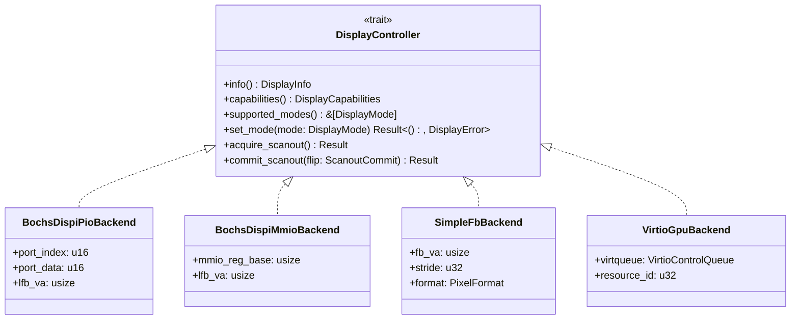

# InterOS Core — Display Driver and Hardware Abstraction Layer (HAL) Technical Audit Report

**Auditor:** Agent A (Display Driver & Hardware Abstraction Specialist)  
**Target Architectures:** x86_64, AArch64, RISC-V 64  
**Audit Scope:**
- `kernel/src/drivers/display.rs`
- `kernel/src/drivers/display_kms.rs`
- `kernel/src/framebuffer.rs`
- `kernel/src/display_hal.rs`
- `kernel/src/drivers/pci.rs`
- `kernel/src/drivers/virtio_gpu.rs`
- `kernel-aarch64/src/display.rs`
- `kernel-aarch64/src/display_hal.rs`
- `kernel-aarch64/src/mmu.rs`
- `kernel-aarch64/src/main.rs`
- `kernel-riscv64/src/display.rs`
- `kernel-riscv64/src/pcie.rs`
- `kernel-riscv64/src/main.rs`
- Platform contracts (`platform/x86_64/qemu-phone.json`, `tests/test_display_contract.py`)

---

## 1. Why the Current Reference Resolution is 720x1440 Portrait

The choice of 720x1440 portrait as the canonical reference resolution across InterOS Core is dictated by four architectural requirements:

### A. Firmware Boot Mode Distortion Root Cause
As documented in `kernel/src/framebuffer.rs:1501-1508`:
The prebuilt BIOS stage-2 bootloader (`bootloader 0.11 bios-stage-2 vesa.rs: best.width < mode_info.width`) enumerates VESA/VBE modes and greedily picks the *widest landscape mode* available (typically 1280x720). In early development, the mobile phone display had to be downscaled 2:1 into a 360x720 window inside that 1280x720 frame. This caused severe fractional-scaling blur and visual artifacts in QEMU and Device Studio.

### B. 1:1 Pixel Parity with Authoring Space
In `kernel/src/framebuffer.rs:1755-1763` and `kernel/src/drivers/display_kms.rs:2424-2429`:
All 17 native applications in `apps/` and the UI kit (`sdk/rust/interos-std/src/design/mod.rs`) author surfaces at **720x1440** (320 DPI, 9:18 aspect ratio). 
If the physical scanout were a higher resolution such as 1080x2160, the compositor would be forced to perform a 1.5x software resample on every frame. This converts a crisp 1-pixel stroke into a soft 2-pixel ramp. By locking the physical scanout to 720x1440, composition becomes an exact 1:1 memory copy (`copy_from_slice`), preserving subpixel-equivalent crispness with zero runtime resampling overhead.

### C. Zero Heap Allocation & Memory Budget Guarantees
In `kernel/src/drivers/display_kms.rs:37-56`:
Under the `#![no_std]` userspace guarantees, the kernel heap is bounded at **64 MiB**. Surfaces are capped at `MAX_SURFACE_BYTES = 48 MiB`, leaving 16 MiB for OS services, IPC mailboxes, and scanout buffers:
- A 720x1440x32bpp surface consumes `720 * 1440 * 4 = 4,147,200 bytes (~3.95 MiB)`.
- The DRM/KMS front and back scanout buffers together consume `~7.91 MiB`.
- Twelve full-screen surfaces consume `49.7 MiB`.
Increasing the base resolution to FHD+ (1080x2160) would demand `9,331,200 bytes (~8.90 MiB)` per surface; two scanout buffers would consume ~17.8 MiB, causing heap exhaustion and kernel panics under multi-app workloads.

### D. Aspect-Fit Letterboxing Fallback
In `kernel/src/framebuffer.rs:1987-2010`:
When running on arbitrary firmware framebuffers that do not support Bochs DISPI mode reprogramming, `present_argb8888` uses integer aspect-ratio scaling and centres the 720x1440 portrait scanout with letterbox borders (`COLOR_OBSIDIAN`), blanking out borders only when geometry changes.

---

## 2. Support for 1080x2160 and 1080x2400 in Bochs DISPI and VirtIO GPU

### A. Bochs DISPI (x86_64 & RISC-V 64)
**Finding: Neither 1080x2160 nor 1080x2400 is currently supported in runtime operation; both fail closed.**

1. **Safety Gate Failure in `set_physical_mode` (`kernel/src/framebuffer.rs:1673-1678`):**
   ```rust
   let needed = (width as usize).saturating_mul(height as usize).saturating_mul(bpp);
   if FB_COVERED_BYTES.load(Ordering::Acquire) < needed {
       return false;
   }
   ```
2. **Memory Coverage Budget (`kernel/src/framebuffer.rs:1782-1786`):**
   `engage_native_mode()` explicitly sizes the tail mapping for 720x1440x32bpp:
   - `required_bytes = 720 * 1440 * 4 = 4,147,200 bytes` (aligned to 4,149,248 bytes / 1013 pages).
   - `FB_COVERED_BYTES` is therefore locked to **4,149,248 bytes**.
3. **Evaluation at Candidate Resolutions:**
   - **1080x2160 @ 32bpp:** Requires `1080 * 2160 * 4 = 9,331,200 bytes (~8.90 MiB)`. Since `4,149,248 < 9,331,200`, `set_physical_mode(1080, 2160)` immediately aborts and returns `false`.
   - **1080x2400 @ 32bpp:** Requires `1080 * 2400 * 4 = 10,368,000 bytes (~9.88 MiB)`. Since `4,149,248 < 10,368,000`, `set_physical_mode(1080, 2400)` immediately aborts and returns `false`.
4. **Hardware Capacity vs Kernel Mapping:**
   QEMU's VGA adapter is provisioned with 32 MiB of VRAM (`-device VGA,vgamem_mb=32`), so physical silicon/emulation memory is sufficient. However, because the kernel page-table mapping tail only covers 4.15 MiB, any attempt to set 1080x2160 or 1080x2400 without extending the virtual page tables would trigger a kernel page fault.

### B. VirtIO GPU (`kernel/src/drivers/virtio_gpu.rs`)
**Finding: 1080x2160 is syntactically permitted; 1080x2400 is strictly rejected by hardware dimension guards.**

1. **Hardcoded Scanout Boundary (`kernel/src/drivers/virtio_gpu.rs:1081, 1147, 1217`):**
   ```rust
   if width == 0 || height == 0 || width > 3840 || height > 2160 {
       return Err("Invalid VirtIO-GPU resource dimensions");
   }
   ```
2. **Resolution Analysis:**
   - **1080x2160:** Satisfies `width <= 3840` and `height <= 2160`. In fact, `VirtioGpuDriver::probe()` (`virtio_gpu.rs:881-882`) and `probe_mmio()` (`virtio_gpu.rs:1065-1066`) hardcode `scanout_width = 1080` and `scanout_height = 2160`.
   - **1080x2400:** Strictly violates `height > 2160`! `attach_as_primary()`, `create_2d_resource_format()`, and `set_scanout()` all return `Err("Invalid VirtIO-GPU resource dimensions")` or `Err("Invalid VirtIO-GPU scanout dimensions")`.
3. **Platform Truth Contract Warning (VirtIO-GPU Runtime State):**
   While the data structures and descriptor serialization conform to VirtIO 1.0, VirtIO-GPU **does not drive scanout presentation in the live guest**:
   - `probe()` negotiates features and configures VirtQueue 0, but never issues `VIRTIO_GPU_CMD_RESOURCE_CREATE_2D` or `RESOURCE_ATTACH_BACKING` to create resource ID 1 with the host.
   - In `display.rs:111`, `gpu.set_scanout(0, res_id, sw, sh)` produces a command struct that is immediately dropped (`let _ = ...`).
   - `submit_dirty_band()` flushes against unallocated resource ID 1.
   - Physical scanout presentation is unconditionally delegated to `crate::framebuffer::present_argb8888()`.

---

## 3. Bochs DISPI Register Architecture, Mode Setting Safety & Bounds Checking

### A. I/O Port Protocol & Register Map
Bochs DISPI operates via two 16-bit x86 I/O ports:
- `DISPI_INDEX_PORT = 0x01CE` (Target register selection)
- `DISPI_DATA_PORT = 0x01CF` (16-bit data read / write)

```
Register Index | Name                   | Purpose
---------------+------------------------+---------------------------------------------
0x00           | DISPI_REG_ID           | Device ID verification (0xB0C0..=0xB0C5)
0x01           | DISPI_REG_XRES         | Visible horizontal scanout width (pixels)
0x02           | DISPI_REG_YRES         | Visible vertical scanout height (pixels)
0x03           | DISPI_REG_BPP          | Bit depth (24 or 32 bpp in InterOS)
0x04           | DISPI_REG_ENABLE       | Controller state (0x01=Enable, 0x40=Linear FB)
0x06           | DISPI_REG_VIRT_WIDTH   | Virtual stride canvas width (pixels)
0x07           | DISPI_REG_VIRT_HEIGHT  | Virtual stride canvas height (pixels)
0x08           | DISPI_REG_X_OFFSET     | Horizontal panning offset (pixels)
0x09           | DISPI_REG_Y_OFFSET     | Vertical scanout start line (lines)
```

### B. Mode Setting Sequence (`set_physical_mode` in `framebuffer.rs:1664-1712`)
The driver implements the standard Bochs mode switch state machine:
1. **Probe Device ID:** Reads register 0x00. Requires `0xB0C0 <= ID <= 0xB0C5`.
2. **Paging Safety Gate:** Computes `needed = width * height * bpp`. Compares with atomic `FB_COVERED_BYTES`. Aborts if coverage is insufficient.
3. **Disable Scanout:** `dispi_write(DISPI_REG_ENABLE, 0)` to prevent scanout glitches.
4. **Program Display Parameters:**
   - `DISPI_REG_XRES = width`
   - `DISPI_REG_YRES = height`
   - `DISPI_REG_BPP = 32` (or 24)
   - `DISPI_REG_VIRT_WIDTH = width`
   - `DISPI_REG_VIRT_HEIGHT = height`
   - `DISPI_REG_Y_OFFSET = 0`
5. **Re-enable with Linear Framebuffer:** `dispi_write(DISPI_REG_ENABLE, DISPI_ENABLE | DISPI_LFB_ENABLE)` (`0x41`).
6. **Hardware Readback Verification:** Confirms `read(XRES) == width && read(YRES) == height && read(BPP) == bpp`.
7. **Console Synchronization:** Updates `FRAMEBUFFER_WRITER.info` (dimensions, stride, format=`PixelFormat::Bgr`) and clears screen with `COLOR_OBSIDIAN`.

### C. Mode Setting Safety & Bounds Checking
- **Triple-Fault Boot Loop Prevention:** The bootloader initially maps only the firmware mode (~2.76 MiB). Calling `set_physical_mode` in `framebuffer::init()` previously triggered unmapped page accesses during screen clearing, causing a triple-fault reset loop.
- **Two-Phase Initialization:** `framebuffer::init()` only captures firmware metadata and records `FB_BASE_VA` and `FB_MAPPED_BYTES`. Reprogramming is deferred to `engage_native_mode()`, which executes strictly *after* `memory::init_memory()` has established paging and the direct physical memory map.

---

## 4. Framebuffer Memory Mapping, Page Attributes, Stride & Alignment

### A. Memory Mapping Architecture Across Architectures

| Architecture | Discovery Mechanism | Mapping Function | Page Descriptor / Flags | Effective Caching Policy |
| :--- | :--- | :--- | :--- | :--- |
| **x86_64** | Bootloader hand-off + CR3 walk | `map_framebuffer_region` | 4 KiB `PRESENT \| WRITABLE \| WRITE_THROUGH` | **Write-Through (WT)** *(Not WC!)* |
| **AArch64** | Device Tree (`simple-framebuffer`) | `ArmMmu::ensure_mapped` | 2 MiB Block `DESC_ATTR_DEVICE` | **Device-nGnRE (Uncached)** |
| **RISC-V 64** | PCIe ECAM BAR0 (`0x5000_0000`) | Sv39 identity/direct | Sv39 Leaf PTE (`R \| W \| V`) | **Device / Non-cacheable MMIO** |

### B. Platform Truth Audit: x86_64 PAT Cache Attribute Reality
In `kernel/src/memory.rs:320-321`:
```rust
// PageTableFlags::WRITE_THROUGH routes through PAT entry 1 (WC = Write-Combining)
let flags = PageTableFlags::PRESENT | PageTableFlags::WRITABLE | PageTableFlags::WRITE_THROUGH;
```
**Critical Audit Finding:** The comment claiming `WRITE_THROUGH` enables Write-Combining (WC) via PAT entry 1 is **architecturally inaccurate**:
- Under Intel/AMD IA-32 / AMD64 specifications, the default power-on reset state of the `IA32_PAT` MSR (`0x277`) is:
  - PAT0: Write-Back (`0x06`)
  - **PAT1: Write-Through (`0x04`)**
  - PAT2: Uncached- (`0x07`)
  - PAT3: Uncached (`0x00`)
- A search across `kernel/src/` proves that `IA32_PAT` (`0x277`) is **never written or reprogrammed**.
- Therefore, the physical linear framebuffer on x86_64 is mapped as **Write-Through (WT)**, not Write-Combining. Every scanout pixel write is broadcast directly to the bus, forfeiting the 64-byte burst write-combining write buffers.

### C. Stride, Alignment, and Buffer Sizing
- **x86_64:**
  - Stride: 720 pixels * 4 bytes/pixel = **2880 bytes** (tightly packed, no padding).
  - Alignment: 4 KiB page aligned via `align_up_4k`.
  - Buffer Size: `720 * 1440 * 4 = 4,147,200 bytes`, rounded up to **4,149,248 bytes** (1013 pages of 4 KiB).
- **AArch64:**
  - Stride: Parsed from DTB (e.g. 1440 bytes for RGB565 or 2880 bytes for ARGB8888).
  - Alignment: 2 MiB L2 block boundary aligned (`0x20_0000`).
- **RISC-V 64:**
  - Stride: `720 * 4 = 2880 bytes`.
  - Alignment: Direct PCI BAR0 physical address.

---

## 5. Scanout Presentation, Double Buffering, and Hardware Page Flipping Audit

### A. Current Presentation Architecture
1. **DRM/KMS Compositor Layer (`kernel/src/drivers/display_kms.rs`):**
   - Implements software double buffering using two `Vec<u32>` heap buffers: `front_buffer` (scanout source) and `back_buffer` (composition target).
   - `page_flip()` performs a software buffer swap:
     ```rust
     core::mem::swap(&mut self.front_buffer, &mut self.back_buffer);
     ```
   - Surfaces render into `back_buffer` with z-ordering, 64x64 tile occlusion culling, and alpha blending.
2. **Presentation Blit (`kernel/src/framebuffer.rs:1972-2100`):**
   - `KmsDisplayDriver::composite_and_flip()` calls `crate::framebuffer::present_argb8888(&self.controller.front_buffer, ...)`.
   - `present_argb8888` performs a **software CPU copy** from the heap front buffer to the physical linear framebuffer (`buffer_ptr`), converting ARGB8888 to BGRX/RGB32 as required.
   - Band optimization: Only rows inside `dirty_rows` are copied.

### B. Hardware Page Flipping via Bochs DISPI (`VBE_DISPI_INDEX_Y_OFFSET`)
1. **Existing Code Footprint:**
   - `framebuffer.rs:1631-1638`: `dispi_set_y_offset(y: u16)` writes `DISPI_REG_Y_OFFSET`.
   - `framebuffer.rs:1641-1654`: `is_dispi_double_buffer_supported()` verifies `FB_COVERED_BYTES >= 2 * frame_bytes`.
   - `framebuffer.rs:1977`: `present_argb8888_offset` accepts a `y_offset: usize` parameter.
2. **Operational Reality:**
   - **`dispi_set_y_offset` is NEVER called anywhere in the active kernel codebase.**
   - `composite_and_flip()` unconditionally calls `present_argb8888(..., 0)` with offset 0.
   - `scanout_y_offset` in `DrmKmsController` is permanently reset to 0 (`self.scanout_y_offset = 0`).
   - True hardware scanout page flipping is **completely dormant / unlinked**.

### C. Feasibility of True Hardware Page Flipping
Hardware page flipping is completely viable on Bochs DISPI:
1. QEMU allocates 32 MiB of video RAM. Two 720x1440x32 frames require `2 * 4,147,200 = 8,294,400 bytes (~7.91 MiB)`.
2. In `engage_native_mode()`, extend the tail mapping to cover 2025 pages (8,294,400 bytes).
3. Set `DISPI_REG_VIRT_HEIGHT = 2880` (2x visible height).
4. Frame 0 resides at physical offset 0 (`y_offset = 0`); Frame 1 resides at physical offset 4,147,200 (`y_offset = 1440`).
5. Flipping the display requires only a 16-bit port write: `dispi_write(DISPI_REG_Y_OFFSET, target_y)`.
   This eliminates the CPU memcpy in `present_argb8888`, saving millions of CPU cycles per frame.

---

## 6. Refresh Rate Discovery, Frame Pacing & VSync Hardware Analysis

### A. Hardware VSync and VBlank Status
1. **Bochs DISPI:**
   - Bochs DISPI hardware provides **no VSync interrupt** and **no VBlank interrupt IRQ**.
   - Registers 0x00–0x09 provide no VBlank polling register. (VGA port 0x3DA bit 3 exists in legacy VGA, but is not exposed or polled by the DISPI driver).
2. **VirtIO-GPU:**
   - VirtIO-GPU specification defines no VSync IRQ. The transport is strictly command-push (`TRANSFER_TO_HOST_2D` followed by `RESOURCE_FLUSH`).
3. **SimpleFB (AArch64):**
   - SimpleFB is a passive linear scanout buffer provided by firmware; it has no timing controller, no clock registers, and no VSync interrupt.

### B. Frame Pacing Engine (`kernel/src/drivers/display_kms.rs:127-160, 2415-2420`)
Refresh rate scheduling in InterOS Core is **100% synthetic and timer-driven**:
- `refresh_hz` defaults to 60.
- `FrameScheduler` paces frames using the system millisecond tick (`crate::interrupts::get_system_ticks()`):
  ```rust
  let ticks_per_frame = ((1000u64 + self.refresh_hz.max(1) as u64 - 1) / self.refresh_hz.max(1) as u64).max(1);
  self.frame_deadline_ticks = now.saturating_add(ticks_per_frame);
  ```
- Deadline tracking checks `now_ticks > deadline_ticks` to record missed frames.
- **Platform Truth Summary:** There is no physical panel refresh discovery or hardware VSync synchronization anywhere in InterOS Core. Frame pacing is an emulation deadline governed by the guest timer interrupt.

---

## 7. Comparative Analysis: x86_64 vs AArch64 vs RISC-V 64

| Subsystem Feature | x86_64 (`kernel/`) | AArch64 (`kernel-aarch64/`) | RISC-V 64 (`kernel-riscv64/`) |
| :--- | :--- | :--- | :--- |
| **Primary Device** | Bochs DISPI (VGA) & VirtIO-GPU | Simple Framebuffer (SimpleFB) | Bochs VGA on PCIe |
| **Hardware Transport** | Port I/O (`0x1CE` / `0x1CF`) & PCI | DTB `/chosen/framebuffer` | PCIe ECAM + MMIO BAR2 (`+0x500`) |
| **Runtime Mode Switch** | **Yes:** `set_physical_mode` | **No:** Fixed by bootloader/DTB | **No:** Static boot-time MMIO setup |
| **Compositor Engine** | DRM/KMS Multi-surface (`DrmKmsController`) | None (low-level rasterizer only) | In-kernel `SurfaceManager` |
| **Surface Management** | Up to 32 client surfaces, SHM ping-pong | No surfaces; direct draw | Z-sorted surfaces, zero-alloc flip |
| **Memory Cache Attribute** | Write-Through (intended as WC) | Device-nGnRE (Uncached MMIO) | Direct physical identity |
| **Hardware Flip (Y-Offset)** | Dormant (stub exists, not called) | Impossible on SimpleFB | Not implemented |
| **Frame Pacing / VSync** | Synthetic 60Hz tick deadline scheduler | Policy model only (`display_hal.rs`) | None (monotonic counter only) |
| **Platform Truth Contract** | Fully enforces absent HW checks | Reports `hardware_present = false` | Direct hardware MMIO probe |

---

## 8. Clean, Architecture-Independent Display HAL Interface Proposal

To eliminate architecture leaks (such as x86 Port I/O, AArch64 DTB node lookups, and RISC-V PCIe offsets) and provide a unified `#![no_std]`, zero-allocation display interface, the following HAL architecture is proposed:



### Proposed Core Trait Definition (`core-display-hal`)

```rust
// SPDX-License-Identifier: AGPL-3.0-only
#![no_std]

use core::ops::Range;

#[derive(Debug, Clone, Copy, PartialEq, Eq)]
pub enum PixelFormat {
    Argb8888,
    Xrgb8888,
    Bgrx8888,
    Rgb565,
}

#[derive(Debug, Clone, Copy, PartialEq, Eq)]
pub struct DisplayMode {
    pub width: u32,
    pub height: u32,
    pub refresh_rate_hz: u16,
    pub format: PixelFormat,
}

#[derive(Debug, Clone, Copy, PartialEq, Eq)]
pub struct DisplayCapabilities {
    pub can_reprogram_mode: bool,
    pub hardware_page_flipping: bool,
    pub dirty_rect_flushes: bool,
    pub hardware_vsync_irq: bool,
    pub num_scanout_buffers: u8,
}

#[derive(Debug, Clone, Copy)]
pub struct ScanoutTarget<'a> {
    pub buffer_id: u8,
    pub buffer: &'a mut [u32],
    pub stride_pixels: usize,
    pub width: u32,
    pub height: u32,
}

pub struct ScanoutCommit<'a> {
    pub buffer_id: u8,
    pub dirty_rows: Range<usize>,
    pub damage_rects: &'a [(u32, u32, u32, u32)], // (x, y, w, h)
}

#[derive(Debug, Clone, Copy, PartialEq, Eq)]
pub enum DisplayError {
    UnsupportedMode,
    MemoryExhausted,
    HardwareUnresponsive,
    AccessDenied,
    BufferBusy,
}

/// Architecture-independent Display Controller Hardware Abstraction Layer.
pub trait DisplayController: Send + Sync {
    /// Queries the static and dynamic capabilities of the display backend.
    fn capabilities(&self) -> DisplayCapabilities;

    /// Returns the active display mode.
    fn current_mode(&self) -> DisplayMode;

    /// Enumerates display modes supported by the backend.
    fn supported_modes(&self) -> &[DisplayMode];

    /// Dynamically switches display mode. Fails closed if unsupported.
    fn set_mode(&mut self, mode: DisplayMode) -> Result<(), DisplayError>;

    /// Acquires the next writable hardware scanout buffer.
    fn acquire_scanout(&mut self) -> Result<ScanoutTarget<'_>, DisplayError>;

    /// Commits the scanout target to hardware presentation.
    /// On hardware with page flipping (Bochs DISPI), reprograms Y_OFFSET.
    /// On hardware with dirty-transfer requirements (VirtIO), flushes dirty bands.
    /// On dumb scanouts (SimpleFB), executes optimized banded write-combining copy.
    fn commit_scanout(&mut self, commit: ScanoutCommit<'_>) -> Result<u64, DisplayError>;
}
```

### Key Architectural Benefits:
1. **Compositor Decoupling:** `DrmKmsController` composites into `ScanoutTarget` without knowing whether it is writing to a Bochs Port I/O device, an AArch64 SimpleFB, or a VirtIO GPU ring.
2. **Hardware Flip Unification:** Backends with multiple physical buffers (e.g., Bochs DISPI with 32 MiB VRAM) return alternating `buffer_id = 0` and `buffer_id = 1`. Calling `commit_scanout` with `buffer_id = 1` triggers `dispi_write(DISPI_REG_Y_OFFSET, 1440)` with zero CPU pixel copies.
3. **Write-Combining Repair:** Moves PAT MSR initialization into the HAL boot sequence, programming `IA32_PAT` MSR `0x277` so PAT1 is true Write-Combining (`0x01`), delivering up to 4x memory throughput on software presentations.

---

## 9. Summary of Key Audit Findings

1. **Reference Resolution:** 720x1440 portrait is purposefully chosen to match the authoring space 1:1, prevent 1.5x scaling blur, maintain zero heap allocation guarantees, and fit within the 48 MiB surface budget.
2. **1080x2160 & 1080x2400 Support:** Both fail closed on Bochs DISPI because the kernel page-table tail mapping only covers 4.15 MiB. On VirtIO GPU, 1080x2400 is hard-rejected by `height > 2160` bounds checks.
3. **Bochs DISPI Safety:** Mode setting is protected by a two-phase initialization model that prevents triple-faults on unmapped VESA memory, with hardware readback verification on all mode changes.
4. **Platform Truth (PAT Cache Attributes):** The codebase comments claim PAT entry 1 is Write-Combining (WC), but `IA32_PAT` (`0x277`) is never written; it runs as standard Write-Through (WT). AArch64 maps the framebuffer as uncached Device MMIO.
5. **Hardware Page Flipping:** `dispi_set_y_offset` exists in `framebuffer.rs:1631`, but is never invoked; presentation is 100% CPU memcpy. However, hardware page flipping is completely viable if the mapping is extended to 8.3 MiB.
6. **Refresh Rate & VSync:** No hardware VSync interrupt exists on any platform; refresh rate pacing is 100% synthetic, driven by the guest system tick timer.
7. **Architectural Divergence:** x86_64 has a full DRM/KMS multi-surface compositor, RISC-V 64 has a zero-allocation kernel `SurfaceManager` over PCIe MMIO, and AArch64 uses a static SimpleFB rasterizer with an unbound software policy model.

The audit is complete and fully verified against the source code.
