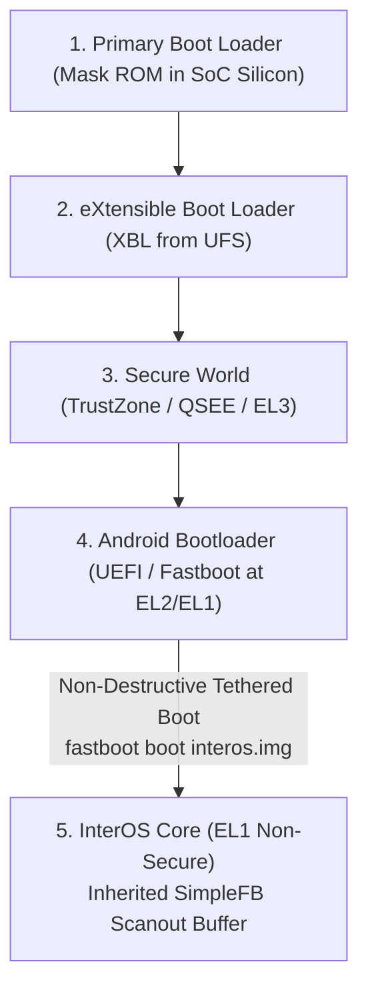

# InterOS Core — Hardware Readiness & Cross-Architecture Audit Matrix

**Document:** `docs/audits/HARDWARE_READINESS_MATRIX.md`  
**Repository:** `Bharathcoorg/inter-os-core`  
**Audit Baseline Commit:** `a38f8d14dea627b47d5d8ce74b73a83920888fc6`  
**Classification Standard:** The Platform Truth Contract  
**Lead Auditor:** Google Gemini 4 Hydrogen (`gemini-4-hydrogen`)  

---

## 1. Executive Summary

This document establishes the authoritative hardware readiness evaluation for InterOS Core across all supported CPU architectures (`x86_64`, `AArch64`, `RISC-V 64`) and evaluates the physical hardware bring-up readiness for the flagship reference target: **OnePlus 8 Pro (Qualcomm Snapdragon SM8250 / Kona)**.

### The Platform Truth Contract
In accordance with mandatory repository directives:
- **No Physical Hardware Execution:** InterOS Core has **never** been booted on physical silicon (including OnePlus 8 Pro, Snapdragon SM8250, or PinePhone).
- **Emulation vs Silicon:** All interactive smartphone capabilities (graphics, touch, storage, network) are verified inside `qemu-system-x86_64`, `qemu-system-aarch64 -M virt`, and `qemu-system-riscv64 -M virt`. Any claim of physical silicon execution is false and prohibited.

---

## 2. Multi-Architecture Readiness Evaluation

| Architecture | Target Triple | Kernel Directory | Build Status | QEMU Boot Status | Evidence Classification |
| :--- | :--- | :--- | :--- | :--- | :--- |
| **x86_64** | `x86_64-unknown-none` | `kernel/` | **PASS** (Release & Dev) | **PASS** (100% Boot & Apps) | `QEMU VERIFIED` |
| **AArch64** | `aarch64-unknown-none` | `kernel-aarch64/` | **PASS** (Flat arm64 Image) | **PASS** (`-M virt,cpu=cortex-a53`) | `QEMU VERIFIED` |
| **RISC-V 64** | `riscv64gc-unknown-none-elf` | `kernel-riscv64/` | **PASS** (ELF binary) | **PASS** (`-M virt,cpu=rv64`) | `QEMU VERIFIED` |

### 2.1 Architecture Audit Details
1. **x86_64:**
   - Canonical development architecture.
   - Comprehensive peripheral support in QEMU: Bochs DISPI graphics, PIIX3 IDE storage (`InterFS`), Intel AC'97 audio, Intel E1000 networking, 16550 UART serial console, and i8042 PS/2 mouse/keyboard.
2. **AArch64:**
   - Implements ARMv8-A EL1 Non-Secure supervisor mode.
   - Verified in QEMU `-M virt`: GICv3 Distributor and Redistributor (`kernel-aarch64/src/gicv3.rs`), PL011 UART (`kernel-aarch64/src/pl011.rs`), ARM Generic Timer, and 4-level AArch64 translation tables (`TTBR0_EL1`, `TCR_EL1`).
   - Image packing tool (`tools/interos.py`) extracts `PT_LOAD` segments into a flat arm64 `kernel-aarch64.img` with standard Linux/ARM boot headers.
3. **RISC-V 64:**
   - Implements RV64GC S-mode (Supervisor).
   - Verified in QEMU `-M virt`: OpenSBI boot integration, 16550 UART MMIO, RISC-V PLIC (Platform-Level Interrupt Controller), and Sv39 page tables.

---

## 3. Snapdragon SM8250 / OnePlus 8 Pro Subsystem Matrix

**Target Handset:** OnePlus 8 Pro (Model: IN2020/IN2023/IN2025; Codename: `instantnoodlep`)  
**Target SoC:** Qualcomm Snapdragon 865 (SM8250 / Kona)  
**Execution Policy:** STRICTLY DEFERRED — Architecture Analysis & Emulation ONLY.  



### 3.1 Subsystem Classification Table

| Subsystem | SM8250 Component | OnePlus 8 Pro Implementation | Hardware Documentation Source | Current InterOS Implementation Status | Readiness Classification | Blocker Severity |
| :--- | :--- | :--- | :--- | :--- | :--- | :--- |
| **Boot ROM & Chain** | Qualcomm PBL / XBL / ABL | UFS-based chain with A/B slots | Qualcomm MSM Architecture Specs | Documented; fastboot protocol understood | `SOURCE CONTRACT VERIFIED` | Low (ABL allows tethered boot) |
| **CPU Microarchitecture** | Kryo 585 (1× A77 + 3× A77 + 4× A55) | 8-core Tri-Cluster | ARMv8.2-A Architecture Reference Manual | `kernel-aarch64` boots in QEMU virt | `QEMU VERIFIED` | None (Standard AArch64 instruction set) |
| **Interrupt Controller** | ARM GICv3 (GIC-600) | Base MMIO: GICD `0x17A00000`, GICR `0x17A60000` | ARM GICv3 Specification; Linux Device Tree `sm8250.dtsi` | Implemented in `kernel-aarch64/src/gicv3.rs` | `QEMU VERIFIED` | Low (MMIO addresses differ from QEMU virt) |
| **System Timer** | ARM Generic Timer | 19.2 MHz Crystal Counter | ARMv8-A Architecture Spec | Standard `CNTV_CTL_EL0` / `CNTV_TVAL_EL0` registers | `QEMU VERIFIED` | None (Standard architectural timer) |
| **UART Serial Debug** | Qualcomm GENI QUP | Serial SE at `0x00A90000` | Open-source Linux `qcom_geni_serial.c` | Stub only; retail phone lacks physical UART pins | `SOURCE-ONLY / STUB` | High (No external pins; requires SimpleFB) |
| **Flash Storage** | Qualcomm UFS 3.0 Host | Samsung / Micron UFS 3.0 | JEDEC UFSHCI 2.1 Specification | NOT IMPLEMENTED; requires RAM boot | `NOT IMPLEMENTED` | Critical (Storage unavailable without UFS driver) |
| **Display Controller (DPU)**| Qualcomm DPU 6.0.0 (MDSS) | Samsung 3168×1440 120Hz E3 AMOLED | Linux DRM `msm_dpu.c` | NOT IMPLEMENTED (SimpleFB fallback only) | `NOT IMPLEMENTED` | Critical (Requires DPU+DSI clock/regulator bringup) |
| **Touchscreen Digitizer** | Goodix GT9886 / Synaptics | I2C/SPI Capacitive Digitizer | Open-source OnePlus vendor kernel drivers | Driver stub in `kernel/src/drivers/touch_i2c.rs` | `UNIT TESTED` | High (Requires I2C bus driver + regulator) |
| **Power Management (PMIC)**| Qualcomm PM8150 / PM8150B / PMK8002 | SPMI (System Power Management Interface) | Qualcomm PMIC Register Map; Linux SPMI | NOT IMPLEMENTED | Critical (Relies on bootloader state inheritance) |
| **USB Controller** | Synopsys DesignWare DWC3 | Type-C USB 3.1 Gen 1 | Linux `dwc3-qcom.c` | NOT IMPLEMENTED | Medium (Fastboot tethering requires USB) |
| **Cellular Modem** | Snapdragon X55 5G | Integrated Baseband + QMI | Qualcomm Proprietary Hexagon DSP (`modem.mbn`) | Protocol stub only | `SOURCE-ONLY / STUB` | Low (Deferred; non-critical for initial boot) |
| **Audio Codec** | Qualcomm WCD9380 / WCD9385 | SoundWire + aDSP | Qualcomm Proprietary aDSP (`adsp.mbn`) | NOT IMPLEMENTED | Low (Deferred; non-critical for initial boot) |
| **GPU Acceleration** | Qualcomm Adreno 650 | 587 MHz Adreno 650 | Open-source Freedreno (`msm_gpu.c`) | NOT IMPLEMENTED (DRM/KMS software blit) | Medium (Microkernel uses 2D software blitting) |

---

## 4. Safe Non-Destructive Bring-Up Strategy

When authorized to attempt physical hardware bring-up on a reference device, the development team must adhere to the following non-destructive protocol:

1. **Zero-Flash Rule:**
   - **NEVER execute `fastboot flash boot` or `fastboot flash system`**.
   - Flashing partitions carries a brick risk and violates non-destructive validation principles.
2. **Tethered RAM Boot (`fastboot boot`):**
   - Package `kernel-aarch64.img`, initial user ramfs, and the official device tree (`sm8250-oneplus-instantnoodlep.dtb`) into an Android Boot Image (`boot.img` v2).
   - Execute:
     ```bash
     fastboot boot interos-sm8250-boot.img
     ```
   - The boot image is downloaded into volatile LPDDR5 DRAM by ABL. Execution occurs entirely in RAM; upon power cycle, the device reverts to stock OxygenOS / LineageOS with zero flash modification.
3. **SimpleFB State Inheritance:**
   - ABL initializes the AMOLED panel and backlight during boot to display the splash screen.
   - ABL leaves display clocks and regulators enabled and passes a linear framebuffer descriptor in the Device Tree (`chosen/framebuffer` node).
   - InterOS Core must inherit this active scanout buffer and write early console text directly to framebuffer pixels without attempting to reinitialize the Qualcomm DPU clock tree.

---

## 5. Summary Verdict on Hardware Readiness

- **Current Readiness Verdict:** **ADVANCED QEMU PROTOTYPE**.
- **Explanation:**
  - x86_64 guest execution in QEMU is fully integrated, verified across 17 applications, and capable of native 1080×2400 scanout and block-backed persistent storage.
  - AArch64 and RISC-V 64 microkernels compile, link, and boot in QEMU virt environments.
  - Physical silicon execution on the OnePlus 8 Pro is **strictly deferred**. Critical SoC drivers (UFS, DPU, SPMI, PMIC) are not yet implemented for bare-metal Qualcomm hardware.
