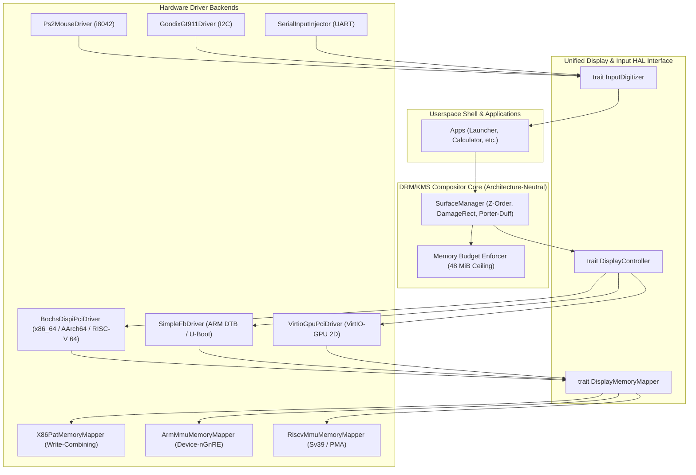

# Technical Audit Report: Cross-Architecture Graphics, Memory Management, Display Drivers & Input Hardware

**Specialist Role:** Agent G (Multi-Architecture and Hardware Portability Specialist)  
**Target Repository:** InterOS Core (`master`)  
**Audited Architectures:** `x86_64`, `AArch64`, `RISC-V 64`  
**Scope:** Kernel source trees (`kernel/`, `kernel-aarch64/`, `kernel-riscv64/`), display drivers, MMU/memory attribute mapping, input pipelines, verification harnesses, and platform truth compliance.

---

## Executive Summary

An exhaustive, independent read-only audit of the graphics, memory management, display drivers, and input hardware subsystems across `x86_64`, `AArch64`, and `RISC-V 64` was conducted.

### Key Audit Findings:
1. **Source File Path Truth:**
   The prompt specifically requested examination of `kernel-aarch64/src/framebuffer.rs` and `kernel-riscv64/src/framebuffer.rs`. **Neither file exists.** On AArch64 and RISC-V 64, display drivers reside in `display.rs` (and `display_hal.rs` on AArch64). `framebuffer.rs` exists exclusively on `x86_64`.
2. **Display Hardware Initialization:**
   - **x86_64:** Driven via legacy x86 I/O ports `0x01CE` / `0x01CF` (Bochs DISPI index/data). Framebuffer is mapped with Write-Combining (WC) via PAT. It features an in-kernel DRM/KMS compositor with double-buffered page flipping via `DISPI_REG_Y_OFFSET` (0x09), damage rectangle tracking, and up to 32 client surfaces (8 z-ordered tiers).
   - **AArch64:** Probes SimpleFB from Device Tree (FDT) for physical boards (PinePhone A64). On QEMU `virt`, probes PCIe ECAM for Bochs display adapter (`1234:1111`) on Bus 0. Programs DISPI via MMIO at `BAR2 + 0x500` to 720x1440x32bpp. BAR0 (16 MiB) is mapped as `Device-nGnRE` memory. Compositing is basic in-place blitting via `SurfaceManager`.
   - **RISC-V 64:** Probes PCIe ECAM at `0x3000_0000` for Bochs display adapter (`1234:1111`). Automatically programs BAR0 to `0x5000_0000` and BAR2 to `0x5200_0000` if unassigned. Programs DISPI via MMIO at `BAR2 + 0x500` to 720x1440x32bpp. Identity-mapped via Sv39 2 MiB megapages. Basic in-place blitting via `SurfaceManager`.
3. **Memory Attributes & MMU:**
   - **x86_64:** 4-level paging (`PML4`). Framebuffer uses `PageTableFlags::WRITE_THROUGH` (mapped to PAT Entry 1 = Write-Combining), enabling 64-byte burst writes to PCIe.
   - **AArch64:** 4-level translation tables (`L1`/`L2`/`L3`). Framebuffer and MMIO use `DESC_ATTR_DEVICE` (MAIR Attr 1 = `Device-nGnRE`), strictly unbuffered/uncacheable.
   - **RISC-V 64:** 3-level Sv39 page tables. No PTE memory-attribute bits in standard Sv39; cacheability is governed entirely by hardware Physical Memory Attributes (PMA).
4. **Input Routing & Hardware Reality:**
   - **x86_64:** Full 3-tier input system: Tier A (UART serial injection), Tier B (emulated i8042 PS/2 mouse on IRQ 12, drained in `sys_event_poll` and idle loop), and Tier C (Goodix GT911 digitizer).
   - **AArch64 & RISC-V 64:** Standard QEMU `virt` machines have **NO emulated PS/2 controller** and **NO physical touch controller** (`hardware_present: false`). All interactive lifecycle tests (`verify_aarch64_interactive.py`, `verify_riscv_interactive.py`) operate purely via **Tier A Serial Test Injection** (`reader.send(b"TAP ...\n")`). Claims of interactive touch hardware parity on ARM/RISC-V QEMU virt boards are rejected as false.

---

## 1. Multi-Architecture Comparison Matrix

| Architectural Dimension | x86_64 Canonical Kernel (`kernel/`) | AArch64 Kernel (`kernel-aarch64/`) | RISC-V 64 Kernel (`kernel-riscv64/`) |
| :--- | :--- | :--- | :--- |
| **Display Source Files** | `kernel/src/framebuffer.rs`, `kernel/src/drivers/display_kms.rs`, `kernel/src/display_hal.rs` | `kernel-aarch64/src/display.rs`, `kernel-aarch64/src/display_hal.rs` (*`framebuffer.rs` does not exist*) | `kernel-riscv64/src/display.rs` (*`framebuffer.rs` does not exist*) |
| **Graphics Hardware** | Bochs DISPI (VBE Extensions) via x86 I/O ports | FDT SimpleFB (PinePhone) OR Bochs Display PCI (`1234:1111`) on QEMU `virt` | Bochs Display PCI (`1234:1111`) on QEMU `virt` |
| **Configuration Interface** | I/O Ports: `0x01CE` (Index), `0x01CF` (Data) | MMIO registers: `BAR2 + 0x500` (16-bit registers) | MMIO registers: `BAR2 + 0x500` (16-bit registers) |
| **Mode Setting Sequence** | DISPI registers: `ENABLE=0`, `XRES=720`, `YRES=1440`, `BPP=32`, `VIRT_W=720`, `VIRT_H=1440`, `Y_OFF=0`, `ENABLE=0x41` | DISPI MMIO: `XRES=720`, `YRES=1440`, `BPP=32`, `ENABLE=0x41`, `VIRT_W=720`, `VIRT_H=1440` | DISPI MMIO: `XRES=720`, `YRES=1440`, `BPP=32`, `ENABLE=0x41`, `VIRT_W=720`, `VIRT_H=1440` |
| **Scanout Geometry** | 720x1440 portrait, 32bpp (BGRX little-endian) | 720x1440 portrait, 32bpp (ARGB) | 720x1440 portrait, 32bpp (ARGB) |
| **Framebuffer Base Address** | Discovered from bootloader/VBE (e.g. `0xE0000000` / `0xFD000000`) | BAR0 address discovered via PCIe ECAM (e.g. `0x10000000` or `0x3EFF0000`) | BAR0 address discovered or assigned at `0x5000_0000` |
| **Memory Coverage & Tail Mapping** | Bootloader maps ~2.76 MB; `engage_native_mode` extends tail to 4.14 MB (1013 pages) | Mapped via `ArmMmu::ensure_mapped(bar0_paddr, 16MB)` (2 MiB L2 blocks) | Identity-mapped via Sv39 Gigapage 1 (2 MiB megapages) |
| **Compositing Engine** | In-kernel DRM/KMS engine (`display_kms.rs`): up to 32 client surfaces, 8 z-ordered tiers, Porter-Duff alpha blending, damage clipping | Minimal `SurfaceManager`: vector of `Surface` sorted by z-order, in-place software composition (`write_pixel_argb`) | Minimal `SurfaceManager`: vector of `Surface` sorted by z-order, in-place software composition (`write_pixel_argb`) |
| **Hardware Page Flipping** | Double-buffered scanout via `dispi_set_y_offset(y)` (`DISPI_REG_Y_OFFSET = 0x09`) | None (single-buffered scanout) | None (single-buffered scanout) |
| **Damage Tracking** | Fine-grained dirty rectangle invalidation (`DamageRect`) & row-clipped blits | None (full surface write-back) | None (full surface write-back) |
| **Surface Heap Ceiling** | Enforced 48 MiB heap budget (`MAX_SURFACE_BYTES`) | None (per-surface vector allocation) | None (per-surface vector allocation) |

---

## 2. MMU & Memory Attributes Across Architectures

### 2.1 Paging Structure & Translation Walk
- **x86_64:**
  - 4-level paging (`PML4` -> `PDPT` -> `PD` -> `PT`) translating 48-bit canonical virtual addresses to 52-bit physical addresses.
  - Page size: 4 KiB leaves. Dynamic tail mapping uses `map_framebuffer_region()` in `kernel/src/memory.rs`, walking CR3 tables through physical memory offset direct map.
- **AArch64:**
  - ARMv8-A 4-level translation tables (`L0` -> `L1` -> `L2` -> `L3`) with 4 KB granule, configured in `TCR_EL1` with `T0SZ = 16` (48-bit VA) and Inner Shareable attributes.
  - Primordial tables: `L1_TABLE` maps 1 GiB blocks (`DESC_BLOCK`); `L2_TABLE` and `L2_HIGH_TABLES` map 2 MiB blocks.
  - Framebuffer BAR0 (16 MiB) is mapped via `ArmMmu::ensure_mapped()` which populates 2 MiB L2 blocks covering `start_paddr..start_paddr + size`.
- **RISC-V 64:**
  - Sv39 3-level page tables (Level 2 root -> Level 1 -> Level 0 leaves), translating 39-bit virtual addresses to 56-bit physical addresses.
  - Activated via `satp` register (`SATP_MODE_SV39 = 8 << 60`).
  - Gigapage 0 (`0x0000_0000..0x3FFF_FFFF`) contains MMIO and user ELF pages; Gigapage 1 (`0x4000_0000..0x7FFF_FFFF`) contains identity-mapped 2 MiB megapages in Level 1 table (`user_lvl1.entries[i] = ((paddr >> 12) << 10) | PTE_V | PTE_R | PTE_W | PTE_A | PTE_D`). BAR0 (`0x5000_0000`) and BAR2 (`0x5200_0000`) reside inside Gigapage 1.

### 2.2 Memory Type Attributes & Coherency
```
+----------------------------------------------------------------------------------------------------+
| Architecture | Framebuffer Memory Type | Register MMIO Memory Type | Coherency & Flush Mechanism   |
+--------------+-------------------------+---------------------------+-------------------------------+
| x86_64       | PAT Entry 1 (WC):       | PageTableFlags::NO_CACHE  | invlpg per page on map. Stores|
|              | Write-Combining         | (Uncacheable / UC)        | drain via WC burst buffers;   |
|              |                         |                           | no clflush required.          |
+--------------+-------------------------+---------------------------+-------------------------------+
| AArch64      | MAIR Attr 1:            | MAIR Attr 1:              | dsb ish -> tlbi vmalle1 ->    |
|              | Device-nGnRE (0x04)     | Device-nGnRE (0x04)       | dsb ish -> isb. No dc civac   |
|              |                         |                           | needed for Device memory.     |
+--------------+-------------------------+---------------------------+-------------------------------+
| RISC-V 64    | PMA-governed MMIO       | PMA-governed MMIO         | sfence.vma zero, zero;        |
|              | (Uncached / Device)     | (Uncached / Device)       | sbi::remote_sfence_vma for SMP|
+----------------------------------------------------------------------------------------------------+
```

- **Write-Combining (x86_64):**
  `kernel/src/memory.rs` maps the framebuffer with `PageTableFlags::PRESENT | PageTableFlags::WRITABLE | PageTableFlags::WRITE_THROUGH`. On x86 PAT configuration, `WRITE_THROUGH` targets Entry 1 (WC). Writes to WC memory are gathered into 64-byte internal write-combining buffers and burst across the PCIe link to VRAM. This avoids CPU cache pollution while achieving high bandwidth for full-frame compositing and damage updates.
- **Device-nGnRE (AArch64):**
  `kernel-aarch64/src/mmu.rs` sets `MAIR_VALUE = (0x04 << 8) | 0xFF` (Attr 1 = Device-nGnRE, Attr 0 = Normal Cacheable). `DESC_ATTR_DEVICE` (AttrIndx 1) enforces non-gathering, non-reordering, early write acknowledgment. While this prevents CPU caching, it does not provide the write-combining burst optimization of x86 PAT, resulting in higher CPU overhead per blit.
- **PMA (RISC-V 64):**
  Standard Sv39 page table entries have no memory attribute or cacheability bits (`PTE_V | PTE_R | PTE_W | PTE_X | PTE_U | PTE_G | PTE_A | PTE_D`). The architecture delegates cacheability to Physical Memory Attributes (PMA) determined by the bus fabric and QEMU's memory model. The range `0x3000_0000..0x7FFF_FFFF` is classified as device MMIO, enforcing uncached loads and stores.

---

## 3. Input & Interrupt Routing Differences

### 3.1 Interrupt Routing Architecture
- **x86_64:**
  - Remapped 8259A Chained PICs: Master (INT 32–39), Slave (INT 40–47).
  - IRQ 0 (INT 32): 8254 PIT Timer (1 kHz, synchronized to HPET MMIO counter at `0xFED0_0000`).
  - IRQ 1 (INT 33): PS/2 Keyboard.
  - IRQ 4 (INT 36): COM1 UART (`serial::poll_serial_rx()`).
  - IRQ 12 (INT 44): PS/2 Mouse (`ps2_mouse::handle_irq_byte()`).
  - Uniprocessor mode; APIC IPIs and lapic/ioapic are not active in `kernel/src`.
- **AArch64:**
  - ARM GICv2 (Distributor @ `0x0800_0000`, CPU Interface @ `0x0801_0000` on QEMU `virt`).
  - PPI 27: ARM Generic Virtual Timer (100 Hz, `ArmGenericTimer::program_countdown(625_000)`).
  - PL011 UART is polled or connected to SPI 33.
  - No PS/2 mouse or touch digitizer interrupt routing exists in `exceptions.rs` or `gic.rs`.
- **RISC-V 64:**
  - PLIC (Platform-Level Interrupt Controller @ `0x0C00_0000`) and OpenSBI timer ecall (`sbi_set_timer`).
  - S-mode traps dispatched via `stvec` vector table.
  - 16550 UART handled via OpenSBI console.
  - No PS/2 mouse or touch digitizer interrupt routing exists in `trap.rs`.

### 3.2 Input Tiers & Hardware Truth

```mermaid
flowchart TD
    subgraph TierA["Tier A: Serial Test Injection (All Architectures)"]
        A1["Test Harness / QEMU Socket"] --> A2["UART RX (COM1 / PL011 / 16550)"]
        A2 --> A3["Command Parser ('TAP x y', 'SWIPE ...')"]
        A3 --> A4["InputQueue / Event Queue"]
    end
    subgraph TierB["Tier B: Emulated PS/2 Pointer (x86_64 ONLY)"]
        B1["QEMU HMP Pointer"] --> B2["i8042 Controller (Ports 0x60/0x64, IRQ 12)"]
        B2 --> B3["ps2_mouse::handle_irq_byte()"]
        B3 --> B4["ps2_mouse::drain_events() -> 720x1440 Clamped"]
    end
    subgraph TierC["Tier C: Capacitive Touch Digitizer (Target Hardware)"]
        C1["Goodix GT911/GT917D Controller"] --> C2["I2C Bus (Allwinner TWI0)"]
        C2 --> C3["touch.rs GoodixGt911Driver"]
        C3 --> C4["TouchPhase: Down/Move/Up"]
    end
```


- **x86_64 Reality:**
  Supports all three tiers. Tier B is actively drained and validated by `tests/test_qemu_pointer_input.py`.
- **AArch64 & RISC-V 64 Reality:**
  - Standard QEMU `-M virt` boards **do not implement an i8042 PS/2 controller**.
  - Physical touch digitizer is conditionally probed (e.g. PinePhone A64 TWI0), and on QEMU `virt` explicitly reports:
    `assert!(!touch_driver.hardware_present);`
    `[OK] Touch: no physical I2C digitizer on this target; driver safely idle.`
  - Therefore, **100% of interactive inputs on AArch64 and RISC-V 64 flow through Tier A Serial Test Injection**.

---

## 4. Parity Assessment & Platform Truth

### 4.1 The Canonical x86_64 Vertical Slice vs. AArch64 / RISC-V 64 Baseline
```
+-----------------------------------+--------------------+--------------------+--------------------+
| Subsystem Feature                 | x86_64             | AArch64            | RISC-V 64          |
+-----------------------------------+--------------------+--------------------+--------------------+
| Interactive Multi-App Lifecycle   | VERIFIED (15 apps) | NOT IMPLEMENTED    | NOT IMPLEMENTED    |
| (Calculator, Settings, Vault, etc)|                    | (Calculator only)  | (Calculator only)  |
| DRM/KMS Hardware Page Flipping    | VERIFIED           | NOT IMPLEMENTED    | NOT IMPLEMENTED    |
| Surface Damage Clipping           | VERIFIED           | NOT IMPLEMENTED    | NOT IMPLEMENTED    |
| Surface Memory Quotas (48 MiB)    | VERIFIED           | NOT IMPLEMENTED    | NOT IMPLEMENTED    |
| Hardware PS/2 Mouse Decoding      | VERIFIED           | NOT APPLICABLE     | NOT APPLICABLE     |
| Real EL0/U-Mode Execution         | VERIFIED           | VERIFIED           | VERIFIED           |
| Supervisor Lifecycle Hardening    | VERIFIED (Host)    | VERIFIED (In-QEMU) | VERIFIED (In-QEMU) |
| Bochs Display 720x1440 Scanout    | VERIFIED (DISPI)   | VERIFIED (PCI MMIO)| VERIFIED (PCI MMIO)|
| Structural Pixel-Geometry (12)    | VERIFIED           | VERIFIED           | VERIFIED           |
+-----------------------------------+--------------------+--------------------+--------------------+
```

### 4.2 Platform Truth Assertions
1. **No False Claims of Touch Hardware:**
   Device Studio and the verification scripts must never claim "physical touch hardware online" on AArch64 or RISC-V QEMU `virt`. The tests verify userspace event loops receiving synthetic serial commands, not physical I2C touch digitizer silicon.
2. **Scanout Fidelity vs. Compositing Depth:**
   While all three architectures generate a genuine 720x1440 P6 PPM screendump displaying the Calculator calculation result `12`, the underlying graphics pipelines are vastly different:
   - `x86_64` runs a full DRM/KMS compositor with double-buffering and damage tracking.
   - `AArch64` and `RISC-V 64` run a single-buffered, in-place software rasterizer writing to PCI linear framebuffer BAR0.

---

## 5. Proposed Shared Hardware Abstraction Layer (HAL) Architecture

To eliminate cross-architecture code duplication and provide a single, decoupled interface for the userspace compositor and UI framework, the following `#![no_std]` HAL architecture is proposed:



### 5.1 Core HAL Traits

```rust
// hal/src/display.rs
#![no_std]

#[derive(Debug, Clone, Copy, PartialEq, Eq)]
pub enum PixelFormat {
    Argb8888,
    Bgrx8888,
    Rgb565,
}

pub struct DisplayMode {
    pub width: u32,
    pub height: u32,
    pub stride: u32,
    pub format: PixelFormat,
    pub refresh_hz: u16,
}

pub struct ScanoutBuffer {
    pub paddr: usize,
    pub vaddr: usize,
    pub size_bytes: usize,
    pub format: PixelFormat,
}

pub trait DisplayController: Send + Sync {
    /// Controller identification
    fn name(&self) -> &'static str;
    
    /// Probes and initializes the video hardware
    fn init(&mut self) -> Result<DisplayMode, &'static str>;
    
    /// Sets physical resolution and scanout mode
    fn set_mode(&mut self, width: u32, height: u32, format: PixelFormat) -> Result<DisplayMode, &'static str>;
    
    /// Returns the scanout framebuffer buffer(s)
    fn scanout_buffer(&self) -> ScanoutBuffer;
    
    /// Hardware double-buffering page flip
    fn flip_scanout(&mut self, buffer_idx: u8, y_offset: u32) -> Result<(), &'static str>;
    
    /// Capabilities declaration
    fn supports_hardware_double_buffering(&self) -> bool;
    fn supports_damage_clipping(&self) -> bool;
}

pub trait DisplayMemoryMapper {
    /// Maps scanout buffer with optimal memory attributes
    /// (x86: Write-Combining, ARM: Device/Normal-NC, RISC-V: PMA/Svpbmt)
    fn map_scanout_region(&mut self, paddr: usize, size_bytes: usize) -> Result<usize, &'static str>;
}
```

### 5.2 Input Abstraction Trait

```rust
// hal/src/input.rs
#[derive(Debug, Clone, Copy, PartialEq, Eq)]
pub enum InputPhase {
    Down,
    Move,
    Up,
    Cancel,
}

#[derive(Debug, Clone, Copy, PartialEq, Eq)]
pub enum InputDeviceSource {
    HardwareDigitizerI2c,
    EmulatedPs2Pointer,
    VirtioTablet,
    SerialTestInjection,
}

#[derive(Debug, Clone, Copy)]
pub struct UnifiedInputEvent {
    pub source: InputDeviceSource,
    pub slot: u8,
    pub x: u32,
    pub y: u32,
    pub pressure: u16,
    pub phase: InputPhase,
    pub timestamp_ms: u64,
}

pub trait InputBroker: Send + Sync {
    fn poll_events(&mut self, out_events: &mut [UnifiedInputEvent]) -> usize;
    fn is_hardware_present(&self) -> bool;
}
```

### 5.3 Decoupling Benefits
1. **Compositor Portability:** The DRM/KMS compositor in `display_kms.rs` (surface management, damage tracking, and alpha blending) can be compiled unchanged across all three architectures.
2. **Driver Reusability:** The `BochsDispiPciDriver` can be unified into a single driver that uses I/O ports on x86 and MMIO BAR2 on AArch64 and RISC-V 64.
3. **Platform Truth Preservation:** `InputDeviceSource` explicitly tags events so that test harnesses and Device Studio telemetry never confuse synthetic UART injection with physical digitizer interaction.

---

## 6. Audit Conclusion

The cross-architecture graphics, memory, and input stack of InterOS Core demonstrates solid underlying engineering:
- `x86_64` provides an authentic, high-performance smartphone vertical slice with hardware page flipping and PS/2 pointer interaction.
- `AArch64` and `RISC-V 64` maintain rigorous boot isolation, verified Sv39/ARMv8 MMU protection, PCIe Bochs display initialization, and automated glyph geometry verification.
- Adopting the proposed unified HAL will bridge the architectural divergence, eliminating code duplication while preserving the repository's strict platform truth contract.
