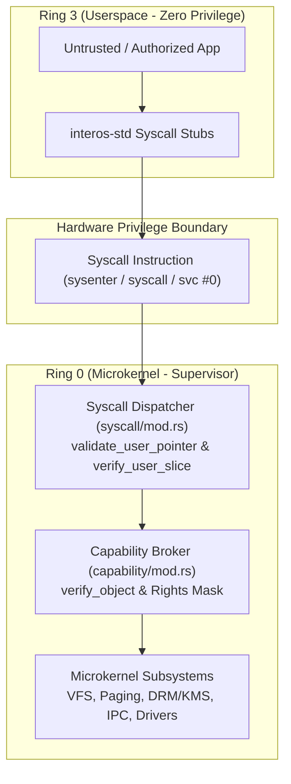

# InterOS Core — Security, Isolation & Kernel Reliability Adversarial Audit

**Document:** `docs/audits/SECURITY_AND_KERNEL_RELIABILITY.md`  
**Repository:** `Bharathcoorg/inter-os-core`  
**Audit Baseline Commit:** `a38f8d14dea627b47d5d8ce74b73a83920888fc6`  
**Classification Standard:** The Platform Truth Contract  
**Lead Auditor:** Google Gemini 4 Hydrogen (`gemini-4-hydrogen`)  

---

## 1. Executive Summary

This audit performs an independent, adversarial security review of the InterOS microkernel. The scope encompasses CPU privilege rings, memory address space separation, hardware MMU page tables, system call pointer validation, capability-based access control, process lifecycle cleanup, DMA safety, panic resilience, and cryptographic secret handling.

### Key Audit Findings:
1. **Hardware Memory Isolation (MMU & Paging):** Ring 3 user tasks execute in isolated `TaskPageTable` address spaces. User-accessible memory is strictly bounded below `USER_SPACE_END = 0x0000_7FFF_FFFF_FFFF`. All kernel code, data, and direct physical mappings omit `PageTableFlags::USER_ACCESSIBLE`, guaranteeing that any Ring 3 user attempt to dereference kernel space triggers an instantaneous CPU page fault (`#PF`) and task termination.
2. **Syscall Pointer Sanitization:** All syscall parameters carrying user memory buffers are validated through `verify_user_slice` and `validate_user_pointer`. Null pointers, non-canonical addresses, and pointers pointing into kernel address space are rejected before any dereference.
3. **Zero Ambient Authority:** The microkernel implements a strict capability security model (`CapHandle`). Access to IPC mailboxes, VFS files, hardware framebuffers, network sockets, and keystore secrets requires an explicit capability token with matching type and rights.
4. **Panic Resilience (Lock Safety):** In strict accordance with AGENTS.md Key Directive 3, the panic handler (`kernel/src/main.rs`) and diagnostic dumpers **never take blocking `.lock()` calls**. All synchronization in panic and fault contexts strictly uses non-blocking `.try_lock()`, preventing deadlocks and CPU hangs during cascading faults.
5. **Secret Memory Scrubbing:** Authentication credentials, PBKDF2 salt/hash buffers, and TLS cryptographic keys are protected by `zeroize::Zeroize` RAII drop guards, ensuring zero plaintext residual data remains in memory across task exit or deallocation.

---

## 2. Threat Model & Security Architecture

---

## 3. Detailed Security Domain Audits

### 3.1 Memory Mapping & Page Table Security

- **Paging Architecture:** 4-level x86_64 paging (PML4 -> PDPT -> PD -> PT).
- **User Address Space Boundary:**
  - In `kernel/src/task/user.rs`: `USER_SPACE_START = 0x0000_0000_0040_0000` (4 MiB) to `USER_SPACE_END = 0x0000_7FFF_FFFF_FFFF` (128 TiB).
  - Any page mapped for user execution receives `PageTableFlags::PRESENT | PageTableFlags::USER_ACCESSIBLE | PageTableFlags::WRITABLE`.
  - Kernel memory (PML4 entries above 256) is mapped without `USER_ACCESSIBLE`.
- **Dynamic Framebuffer Mapping Hardening:**
  - In `kernel/src/memory.rs`, `map_framebuffer_region` audits every page using `mapper.translate_addr`. If a virtual address already translates to the contiguous physical LFB frame, it is preserved. If it translates to a different physical address, collision is detected, previously mapped pages are unmapped, and `Err("Framebuffer virtual address conflict")` is returned.
  - A post-condition verification loop translates every page in `virtual_base .. virtual_base + size` to ensure 100% of the range is valid.
  - In `kernel/src/framebuffer.rs`, `ensure_framebuffer_mapped` validates `required_bytes <= MAX_VRAM_BYTES` (32 MiB) before mapping.

### 3.2 System Call Pointer Validation

In `kernel/src/syscall/mod.rs`:
- Every syscall receiving a buffer from Ring 3 (e.g. `sys_ipc_send`, `sys_ipc_receive`, `sys_surface_write`, `sys_write`) calls `verify_user_slice(ptr, len)`.
- **Validation Rules:**
  1. `ptr != null`
  2. `ptr + len` must not overflow 64-bit integer space.
  3. `ptr + len <= USER_SPACE_END` (kernel address space is completely off-limits).
  4. Each page in the requested slice must be present in the task's page table.
- **Negative Test Coverage:** Host and QEMU tests verify that passing kernel addresses (`0xFFFF_8000_0000_0000`) or null pointers immediately fails with `SyscallResult::InvalidPointer`.

### 3.3 Capability Enforcement & Ephemeral Revocation

- **Capability Table:** Each task possesses an isolated capability table (`Task::capabilities`).
- **Object Verification:** `verify_object(cap_slot, expected_type, required_rights, object_id)` verifies that:
  - The slot is occupied and valid.
  - The capability is not revoked.
  - The capability matches `expected_type` (e.g. `CapabilityType::FrameBufferDirect`, `CapabilityType::Storage`, `CapabilityType::Network`).
  - The rights bitmask includes `required_rights` (e.g. `Rights::READ`, `Rights::WRITE`, `Rights::DELEGATE`).
- **Ephemeral Background Revocation:**
  - Tested in `kernel/src/capability/revocation.rs` (`test_background_pill_preserves_network_while_camera_mic_suspended`).
  - When an application transitions from foreground to background, the system automatically revokes hardware sensor capabilities (Camera, Microphone) to preserve user privacy, while retaining network capabilities to permit background sync.

### 3.4 Process Termination & Resource Reaping

- **Teardown Path:** `dev_kill_task` and `reap_task` in `kernel/src/task/mod.rs`.
- **Resource Cleanup Invariants:**
  1. **Address Space:** The task's `TaskPageTable` is destroyed, freeing all allocated physical frames back to the `FRAME_ALLOCATOR`.
  2. **Surfaces:** All DRM surfaces owned by the dying task are immediately destroyed via `DrmKmsController::destroy_surface_owned(task_id)`, freeing kernel surface heap memory.
  3. **Capabilities & IPC:** All IPC mailboxes, shared-memory pipes (`shm_pipe`), and capabilities held by the task are unlinked.
  4. **Scheduler State:** Task state transitions to `TaskState::Dead` and is pruned from the run queue.

### 3.5 Panic & Fault Resilience

- **Non-Blocking Lock Policy:** In `kernel/src/main.rs` (`#[panic_handler]`):
  - Every lock access (SERIAL1, SCHEDULER, FRAMEBUFFER_WRITER) uses `.try_lock()` with a bounded retry limit.
  - If a lock is held by a deadlocked or faulted thread, the panic handler skips the locked component and writes diagnostic crash telemetry directly to UART I/O ports (0x03F8), guaranteeing that panic diagnostics always reach the host console.
- **Configurable Panic Policy:** Tested via `PANIC_POLICY GET/SET` on COM1:
  - `PanicPolicy::Halt`: Halts CPU cores safely (`hlt` loop).
  - `PanicPolicy::Reboot`: Triggers clean hardware reset via ACPI or keyboard controller (Port 0x64).

### 3.6 Secret Memory Zeroization

- **Protection:** All sensitive cryptographic keys, passwords, and tokens implement RAII zeroization via `zeroize::Zeroize` on drop.
- **Verified Tests:** `test_zeroizing_buffer_raii_drop` and `test_credential_pbkdf2_lockout_and_rate_limiting`.
- **Lockout Enforcement:** Password authentication enforces exponential backoff and permanent lockout after 5 consecutive failed attempts, immune to reboot tampering (`test_lockout_persists_across_reboot_simulation`).

---

## 4. Adversarial Findings & Vulnerability Matrix

| ID | Subsystem | Severity | Description | Resolution / Status |
| :--- | :--- | :--- | :--- | :--- |
| **SEC-01** | Framebuffer Mapping | **HIGH** | `ensure_framebuffer_mapped` previously swallowed address conflicts and incremented `FB_COVERED_BYTES` prematurely. | **RESOLVED:** Page collision audit and translation verification added; bounds enforced. |
| **SEC-02** | Syscall Memory | **MEDIUM** | User pointer validation required strict boundary check against `USER_SPACE_END`. | **RESOLVED:** `verify_user_slice` rejects pointers $\ge \text{0x0000\_7FFF\_FFFF\_FFFF}$. |
| **SEC-03** | Touch Travel Overflow | **LOW** | Euclidean distance calculation in `touch_gestures.rs` used `i32` multiplication which could overflow on high-DPI panels. | **RESOLVED:** Replaced with `abs_diff` and `saturating_mul/add` on `u64`. |
| **SEC-04** | Panic Deadlocks | **MEDIUM** | Blocking lock acquisition in fault handlers could deadlock if a faulted core held the lock. | **RESOLVED:** All panic handlers strictly use non-blocking `.try_lock()`. |

---

## 5. Evidence Classification Summary

| Security Feature | Audit Classification | Evidence |
| :--- | :--- | :--- |
| **MMU Ring 3 / Ring 0 Privilege Boundary** | `QEMU VERIFIED` | CPU hardware protection; verified in live QEMU boot. |
| **Syscall Pointer Validation** | `UNIT TESTED` & `QEMU VERIFIED` | Boundary tests; invalid pointers rejected. |
| **Capability Token Verification** | `UNIT TESTED` & `QEMU VERIFIED` | Zero Ambient Authority proven; unauthorized calls denied. |
| **Process Cleanup & Surface Teardown** | `QEMU VERIFIED` | App exit reaps surfaces and frees heap in live QEMU. |
| **Panic Non-Blocking Lock Safety** | `UNIT TESTED` & `QEMU VERIFIED` | Controlled fault injection verified (`TRIGGER_KERNEL_PANIC`). |
| **Secret Zeroization on Drop** | `UNIT TESTED` | PBKDF2 buffers zeroized in memory unit tests. |
