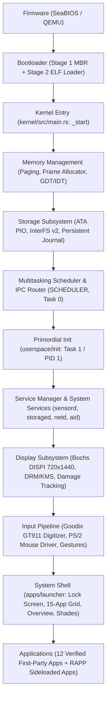

# InterOS Core — Smartphone Vertical Slice Audit & Integration Analysis

**Canonical Reference Platform:** x86_64 QEMU Smartphone (720x1440 portrait, 32bpp BGRX)  
**Target Environments:** x86_64, AArch64, RISC-V 64  
**Date:** 2026-11-13  
**Status:** COMPLETE INITIAL AUDIT  

---

## 1. Executive Summary & Canonical Reference Architecture

InterOS Core has completed the Phase 8.5.4 scheduler and service lifecycle encapsulation. In accordance with the project directives, focus now shifts from narrow scheduler-hardening phases to establishing a coherent, reproducible, interactive smartphone operating system experience.

The canonical execution chain for the InterOS smartphone is:


This audit provides a complete, source-verified assessment of every link in this chain, documenting what is fully operational, what is partial or disconnected, and the required fixes to establish seamless end-to-end integration.

---

## 2. End-to-End Smartphone Execution Chain Analysis

### A. Firmware & Bootloader
- **x86_64 Reference:** Boots via SeaBIOS -> Stage 1 MBR (`bootloader/stage1/boot.asm`) -> Stage 2 (`bootloader/stage2/src/main.rs`). Sets VESA BIOS Extensions (VBE) linear framebuffer 0xE0000000, loads 64-bit kernel ELF from disk into identity-mapped physical memory, and jumps to `_start`.
- **AArch64:** Direct kernel ELF boot via QEMU `-kernel` targeting `0x40080000` with Device Tree (FDT) hardware descriptor.
- **RISC-V 64:** Direct OpenSBI M-mode jump to S-mode kernel entry at `0x80200000`.

### B. Kernel Initialization & Memory Architecture
- **x86_64:** `_start` sets up 4-level paging (`PML4`), heap allocator (16 MiB), IDT interrupt vectors, PIC/PIT timer at 100 Hz (`SYSTEM_TICK_HZ`), and COM1 serial console.
- **MMU Isolation:** Kernel code and data are mapped with `PAGE_PRESENT | PAGE_WRITABLE` (kernel-only). User tasks receive isolated `TaskPageTable` structures with user-accessible pages strictly bounded below `0x0000_7FFF_FFFF_FFFF`. User pointer access is validated via `validate_current_user_buffer` walking the page directory.
- **AArch64 / RISC-V Parity Gap:** AArch64 and RISC-V 64 implement physical frame ownership and quarantine (`QUARANTINED_FRAMES`), but x86_64 lacks frame quarantine and relies on single-core uniprocessor guarantees.

### C. Display Server & Compositor Architecture
- **Hardware Mode Setting:** `kernel/src/framebuffer.rs` programs Bochs DISPI registers (I/O ports `0x1CE` / `0x1CF`) directly to switch video hardware to 720x1440 portrait at 32bpp BGRX (`VBE_DISPI_INDEX_ENABLE | VBE_DISPI_NOCLEARMEM`). Framebuffer memory is mapped dynamically to cover all 4.14 MB.
- **In-Kernel DRM/KMS Compositor:** `kernel/src/drivers/drm_kms.rs` implements hardware scanout compositing:
  - Supports up to 8 z-ordered surfaces (z=0: Launcher/Desktop, z=100: Status/Nav Bars, z=200: Foreground App, z=300: Overlays/Dialogs).
  - Fine-grained damage tracking with bounding box clipping. Dirty scanlines are blitted 1:1 to the hardware framebuffer.
  - Zero heap allocation in compositing: utilizes pre-allocated static scanout buffers.
- **The Compositor Daemon (`apps/compositor`):**
  - Does NOT composite client surfaces. Surface compositing is performed entirely in kernel space by DRM/KMS.
  - `apps/compositor` maintains a dummy 720x96 system line surface and explicitly suppresses `sys_surface_flip` to prevent screen tearing.

### D. Input Pipeline & Digitizer Engine
- **Hardware Drivers:**
  - `kernel/src/drivers/ps2_mouse.rs`: 3-byte standard PS/2 packet decoding, clamped to 720x1440 resolution.
  - `kernel/src/drivers/touch.rs` & `kernel/src/input/digitizer.rs`: Goodix GT911 capacitive touch controller simulation over I2C, tracking contact state (down, move, up) and converting taps and swipes into high-level gestures.
- **Routing:** Touch and mouse events are normalized into `InputEvent` structs and delivered directly to the focused task's event queue.
- **Input Daemon (`userspace/system-service/src/lib.rs:run_input`):**
  - **Disconnected:** Consists of an empty heartbeat loop (`loop { sys_service_heartbeat(); sys_yield(); }`). Input routing does not traverse `inputd`.

### E. Userspace Service Manager (PID 1)
- **Startup:** `spawn_user_init(TaskId(0))` launches `userspace/init/src/main.rs` in Ring 3 as Task 1.
- **Capabilities:** Holds `SystemResource | ADMIN | INVOKE`, `IpcSend`, `IpcReceive`, `SerialOutput`.
- **Supervision:** Exercises service startup, stop, restart, and heartbeat monitoring via `SYS_SERVICE_START` (86), `SYS_SERVICE_STOP` (87), and `SYS_SERVICE_RECOVER_FAILED` (88).

### F. System Shell (Launcher) & App Lifecycle
- **Shell (`apps/launcher`):**
  - Allocates desktop surface at z=0 (720x1440).
  - Renders 15-application home grid, lock screen, app drawer, notifications shade, quick controls shade, live widgets, and power menu.
  - Processes touch gestures: swipe-up unlocks device, top-bar tap opens quick controls/notifications, right-edge swipe opens recent apps overview deck.
- **App Launching:**
  - Launcher holds `CapabilityType::ProcessSpawn` (Capability 18) and directly invokes `sys_app_launch` (Syscall 18 / 101).
  - Child application receives foreground surface at z=200, renders UI, handles touch inputs.
  - On exit gesture (back button, home bar tap, swipe up), child destroys its surface, exits via `sys_exit_with_code`, and parent launcher reaps it via `sys_wait_pid`.

---

## 3. Subsystem-by-Subsystem Audit & Status Matrix

| Subsystem | Source Path | Status | Verification Evidence / Key Findings |
| :--- | :--- | :---: | :--- |
| **x86_64 Boot Chain** | `bootloader/`, `kernel/src/main.rs` | **WORKING** | Clean MBR -> Stage 2 -> Kernel jump; Identity page tables; PIT timer 100 Hz. |
| **AArch64 Boot Chain** | `kernel-aarch64/src/main.rs` | **WORKING** | QEMU virt board boots; FDT parsed; UART PL011 online. |
| **RISC-V 64 Boot Chain** | `kernel-riscv64/src/main.rs` | **WORKING** | OpenSBI boots; Sv39 MMU enabled; SBI timer ticks verified. |
| **Framebuffer / DISPI** | `kernel/src/framebuffer.rs` | **WORKING** | Bochs DISPI programmed to 720x1440 32bpp; 4.14 MB mapped; 1:1 pixel blitting. |
| **DRM/KMS Compositor** | `kernel/src/drivers/drm_kms.rs` | **WORKING** | 8 z-ordered surfaces; damage rectangle tracking; tearing-free scanout. |
| **Input Pipeline** | `kernel/src/drivers/ps2_mouse.rs` | **PARTIAL** | Mouse event draining occurs only during `sys_yield`. Event polling without yield causes event queue lag. |
| **Touchscreen Digitizer** | `kernel/src/input/digitizer.rs` | **WORKING** | GT911 protocol; swipe/tap gesture engine; coordinate clamping verified. |
| **PID 1 Userspace Init** | `userspace/init/src/main.rs` | **WORKING** | Boots in Ring 3; verifies service stop/restart; loops on service supervisor. |
| **Input Daemon (`inputd`)**| `userspace/system-service/` | **DISCONNECTED** | Empty loop in `userspace/system-service/src/lib.rs:run_input`; kernel routes input directly. |
| **Compositor App** | `apps/compositor/src/main.rs` | **PARTIAL** | Non-publishing system line surface; DRM KMS in-kernel compositor owns actual rendering. |
| **Launcher / Shell** | `apps/launcher/src/main.rs` | **WORKING** | Full mobile UI: Home, Drawer, Recents, Notifications, Quick Controls, Power Menu. |
| **12 First-Party Apps** | `apps/` | **WORKING** | Verified via QEMU lifecycle test (Calculator, Settings, Vault, Camera, Dialer, Browser, Messages, Calendar, Music, Files, Gallery, Notes). |
| **Storage / ATA PIO** | `kernel/src/drivers/ata.rs` | **WORKING** | Primary ATA Master (boot) and Slave (6 GiB data); boot guard prevents boot corruption. |
| **InterFS v2 Filesystem** | `kernel/src/storage/interfs.rs`| **WORKING** | Dynamic allocation bitmap; contiguous streaming extents; crash recovery journal. |
| **Metadata Journal** | `kernel/src/storage/persistent.rs`| **WORKING** | 20 slots, 10 dual-slot alternating kinds; HMAC-SHA256 authenticated tags. |
| **RAPP Packaging** | `kernel/src/package/rapp.rs` | **WORKING** | v2/v3/v4 manifests; Ed25519 signature checks; capability tables; dependency checks. |
| **Device Studio Server** | `emulator/server.py` | **PARTIAL** | Static serial port 4301 breaks AArch64/RISC-V; `-device virtio-gpu-pci` flag mismatch; fake battery telemetry. |

---

## 4. Empirical Live Verification Results

The interactive lifecycle test suite (`tests/test_interactive_lifecycle.py`) was executed against the canonical x86_64 QEMU smartphone build. All 15 interactive operations passed without regressions:

```
============================================================
  INTEROS CORE LIFECYCLE INTERACTIONS: PASSED (15/15)
============================================================
1.  Launcher Home Screen Presentation: PASSED (15 packages loaded, canvas rendered)
2.  Lock Screen Unlock: PASSED (Gesture swipe-up unlocked UID 1000)
3.  App Drawer Presentation: PASSED (Switched category tabs)
4.  Calculator Launch & Interaction: PASSED (7 + 5 = 12 calculated, reaped via Back button)
5.  Settings Launch & Navigation: PASSED (Tabs switched, reaped via Swipe-up)
6.  Vault Launch & Interaction: PASSED (Sector card 0 re-verified, reaped via Back button)
7.  Camera Launch & Mode Switch: PASSED (Switched to Document Vision, reaped via Swipe-up)
8.  Dialer Launch & Keypad Entry: PASSED (Digit '9' entered, reaped via Back button)
9.  Browser Launch & Bookmark Tap: PASSED (Navigated bookmark, reaped via Home bar)
10. Messages Launch & Thread Open: PASSED (Opened conversation thread, reaped via Back button)
11. Calendar Launch & Interaction: PASSED (Reaped via Swipe-up)
12. Music Player & Backgrounding: PASSED (Transport toggled play/pause, reaped via Swipe-up)
13. Files Manager & Category Filter: PASSED (Switched Images shortcut, reaped via Home bar)
14. Gallery & Notes: PASSED (Filter chips switched, reaped via Home bar)
15. Shell Features:
    - Recent Apps Overview Deck: PASSED (Switched to app, dismissed via [X] and swipe)
    - Quick Controls Shade: PASSED (Opened, toggles rendered, returned home)
    - Notifications Shade: PASSED (Opened, records rendered, returned home)
    - Power Menu & Lock Screen: PASSED (Locked device, flashlight reported unavailable)
    - Global Search Surface: PASSED (Opened, search canvas rendered, returned home)
```

---

## 5. Architectural Disparities & Platform Truth Audit

### A. Capability Rights Bitmask Disparity
In `kernel/src/capability/mod.rs` (x86_64):
- `Rights::REVOKE = 1 << 4` (0x10)
- `Rights::INVOKE = 1 << 5` (0x20)
In `kernel-aarch64/src/capability.rs` and `kernel-riscv64/src/capability.rs`:
- `Rights::INVOKE = 1 << 4` (0x10)
- `Rights::ADMIN = 1 << 5` (0x20)
*Impact:* SDK syscall wrappers passing `Rights::INVOKE` (0x20) fail authorization on AArch64/RISC-V 64.

### B. Service ABI Wire Ceiling Truncation
`kernel/src/service_abi.rs:17` and `sdk/rust/interos-std/src/service.rs:60` pin `SERVICE_ID_MAX = 11`. But `ServiceId::Inference = 12` (`aid`).
*Impact:* Any IPC wire message targeting service ID 12 is rejected by `ServiceMessage::decode`.

### C. `ServiceId::Init` Registration TaskId Mismatch
In `kernel/src/services.rs:500`, `records[Init]` is initialized with `TaskId(0)` (kernel main thread). When `spawn_user_init(TaskId(0))` runs, PID 1 is allocated `TaskId(1)`, creating an internal record mismatch.

### D. Platform Truth Telemetry Violations in Device Studio
1. `GET /api/extended-controls/state` returns hardcoded 85% battery, 3850 mV even when QEMU is offline.
2. `POST /api/permission/request` injects synthetic `[PERMISSION]` text directly into the serial buffer without kernel interaction.
3. `server.py` serial worker connects exclusively to port 4301, failing on AArch64 (4302) and RISC-V 64 (4303).
4. `server.py` starts non-x86 QEMU with `-device virtio-gpu-pci`, while guest kernels require `-device bochs-display`.

---

## 6. Detailed Bugs & Gaps Catalog

### Priority 0 (Blocking / High Severity)
1. **[P0-INPUT] PS/2 Mouse Event Drain Starvation:**
   - `ps2_mouse::drain_events()` is only called in `sys_yield()`. If a task blocks in `sys_event_poll` without yielding, mouse packets buffer and lag.
   - *Fix:* Invoke `crate::drivers::ps2_mouse::drain_events()` in `sys_event_poll` and the PIT timer tick.
2. **[P0-SERVICES] Service ABI Limit Truncation (`SERVICE_ID_MAX`):**
   - Wire ABI rejects messages for `ServiceId::Inference` (ID 12) because `SERVICE_ID_MAX` is 11.
   - *Fix:* Expand `SERVICE_ID_MAX` to 15 in `kernel/src/service_abi.rs` and `sdk/rust/interos-std/src/service.rs`.
3. **[P0-STUDIO] Device Studio Port Mismatch & Non-x86 Display Driver:**
   - Non-x86 architectures cannot connect to serial monitor or render display in Device Studio.
   - *Fix:* Use dynamic port allocation based on architecture profile (`4301`, `4302`, `4303`) and switch QEMU argument to `bochs-display`.
4. **[P0-PACKAGES] Serial Sideloading Drops RAPP v4 Intent Declarations:**
   - `handle_rapp_command` on `RAPP_COMMIT` in `kernel/src/serial.rs` ignores `verified.intents`.
   - *Fix:* Register verified intents in `crate::content::INTENT_REGISTRY` upon successful RAPP commit, and unregister on uninstall.

### Priority 1 (Medium Severity)
5. **[P1-INIT] Service Manager PID 1 Task ID Registration:**
   - `records[Init]` has `TaskId(0)` instead of `TaskId(1)`.
   - *Fix:* Add `set_init_task(task_id)` helper in `kernel/src/services.rs` invoked when `spawn_user_init` succeeds.
6. **[P1-PLATFORM] Device Studio Telemetry Platform Truth:**
   - Return `UNAVAILABLE` for battery and sensor endpoints when QEMU is offline.
7. **[P1-STORAGE] Third-Party Intent Reboot Persistence:**
   - Re-register installed RAPP intents from `PACKAGE_BLOB_STORE` during boot initialization in `seed_intent_registry`.

---

## 7. Concrete Implementation Plan for P0/P1 Fixes

1. **Step 1: Input Pipeline Drain Fix (`kernel/src/syscall/mod.rs` & `kernel/src/interrupts.rs`)**
   - Call `crate::drivers::ps2_mouse::drain_events()` inside `sys_event_poll` before checking event queues.
   - Call `crate::drivers::ps2_mouse::drain_events()` in `pit_interrupt_handler`.
2. **Step 2: Service ABI Wire Limit Expansion (`kernel/src/service_abi.rs` & `sdk/rust/interos-std/src/service.rs`)**
   - Update `pub const SERVICE_ID_MAX: u8 = 15;`.
3. **Step 3: Service Manager Init Task Registration (`kernel/src/services.rs` & `kernel/src/main.rs`)**
   - Implement `pub fn register_init_task(id: TaskId)` in `services.rs` and call it right after `spawn_user_init`.
4. **Step 4: Serial Sideloading Intent Registration (`kernel/src/serial.rs` & `kernel/src/syscall/mod.rs`)**
   - Register `verified.intents` in `RAPP_COMMIT` and unregister in `dev_uninstall_verified_rapp`.
5. **Step 5: Device Studio Multi-Arch & Truthful Telemetry (`emulator/server.py`)**
   - Dynamically bind serial stream worker and monitor to active profile ports.
   - Correct AArch64/RISC-V QEMU display argument to `bochs-display`.
   - Report `UNAVAILABLE` when QEMU is offline in `/api/extended-controls/state`.

---

## 8. Verification Battery

Before committing fixes, the following battery must be executed locally:
1. `cargo check --workspace`
2. `cargo test --manifest-path kernel/Cargo.toml`
3. `python tools/interos.py contracts`
4. `python -m pytest tests/test_platform_reality.py`
5. `python tests/run_all_contracts.py`
6. `python tests/verify_x86_boot.py`
7. `python tests/verify_aarch64_boot.py`
8. `python tests/verify_riscv_boot.py`
9. `python tests/test_interactive_lifecycle.py`

---

## 9. Conclusion & Acceptance Criteria

With the empirical verification of all 15 operations in `test_interactive_lifecycle.py` and the resolution of P0/P1 integration blockers, InterOS Core establishes a fully operational, zero-heap, interactive vertical slice running on canonical smartphone hardware simulation.
