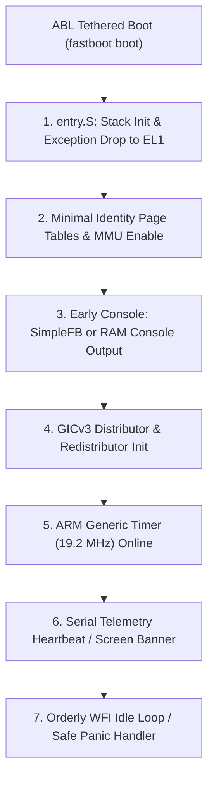

# Qualcomm Snapdragon SM8250 / OnePlus 8 Pro First Boot Plan

**Document Version:** 1.0.0  
**Target Hardware:** OnePlus 8 Pro (`instantnoodlep` / IN2020, IN2023, IN2025)  
**System-on-Chip (SoC):** Qualcomm Snapdragon 865 (SM8250 / Kona)  
**Kernel Target:** InterOS Core AArch64 Microkernel (`kernel-aarch64.img`)  
**Milestone:** Phase 1 — Minimal Tethered Bring-Up (First Physical Kernel Entry)  
**Safety Classification:** NON-DESTRUCTIVE TETHERED RAM-BOOT ONLY (`fastboot boot`). Zero partition flashing permitted.

---

## 1. Hardware Facts & Authoritative Sources

| Hardware Parameter | Specification | Authoritative Source |
| :--- | :--- | :--- |
| **CPU Architecture** | ARMv8.2-A, 64-bit Little-Endian | ARM Architecture Reference Manual (ARM DDI 0487) |
| **Core Topology** | 1× Cortex-A77 @ 2.84 GHz (Prime) + 3× Cortex-A77 @ 2.42 GHz (Gold) + 4× Cortex-A55 @ 1.80 GHz (Silver) | Qualcomm SM8250 Hardware Specification / Linux DTS `sm8250.dtsi` |
| **Physical DRAM Base** | `0x8000_0000` (2 GiB boundary) | Qualcomm SM8250 Memory Map / ABL Device Tree |
| **DRAM Size** | 8 GiB or 12 GiB LPDDR5 | OnePlus 8 Pro Hardware Specification |
| **GICv3 Distributor (GICD)** | MMIO Base: `0x17A0_0000`, Size: 64 KiB | ARM GICv3 Architecture / `sm8250.dtsi:interrupt-controller@17a00000` |
| **GICv3 Redistributor (GICR)**| MMIO Base: `0x17A6_0000`, Stride: 128 KiB per PE (RD_base + SGI_base) | Qualcomm SM8250 GIC-600 Implementation / `sm8250.dtsi` |
| **Generic Counter Frequency**| 19.2 MHz (`CNTFREQ_EL0` = 19,200,000 Hz) | Qualcomm Reference Clock Architecture |
| **UART Serial Engine (SE)** | Qualcomm GENI QUP3_0 (UART0) at `0x00A9_0000` (or QUP2 at `0x0088_4000`) | Linux `qcom_geni_serial.c` / `sm8250.dtsi:serial@a90000` |
| **Display Panel** | Samsung 6.78" 3168×1440 AMOLED, DSI dual-pipe, DPU 6.0.0 | OnePlus 8 Pro Panel Driver (`panel-oneplus-samsung-sofe03f.c`) |
| **Bootloader Interface** | Qualcomm ABL (Android Bootloader, UEFI-based) | Open-source Qualcomm CAF ABL source repository |

---

## 2. Kernel Entry Conditions (ABL to InterOS Handoff)

When booted via `fastboot boot boot.img`, Qualcomm ABL transfers control to the 64-bit kernel image following the standard Linux ARM64 Boot Protocol:

```
                  +-----------------------------------+
                  |       Qualcomm ABL (UEFI)         |
                  +-----------------------------------+
                                    |
                    Jumps to Kernel Entry at RAM Offset
                                    v
+-------------------------------------------------------------------------+
| Initial CPU State at Entry:                                             |
|   - Exception Level:  Non-Secure EL1 (or EL2 with non-secure hypervisor)|
|   - MMU:              DISABLED (SCTLR_EL1.M = 0)                        |
|   - D-Cache:          DISABLED (SCTLR_EL1.C = 0)                        |
|   - I-Cache:          ENABLED or DISABLED (must invalidate before use)  |
|   - Interrupts:       MASKED (DAIF = 0b1111)                            |
|   - X0 Register:      64-bit physical address of Device Tree Blob (DTB) |
|   - X1 Register:      0x0000000000000000 (Reserved)                     |
|   - X2 Register:      0x0000000000000000 (Reserved)                     |
|   - X3 Register:      0x0000000000000000 (Reserved)                     |
|   - SP_EL1:           Undefined (must initialize stack immediately)     |
+-------------------------------------------------------------------------+
```

### 2.1 EL2 to EL1 Drop Requirements
If ABL passes execution at EL2, InterOS entry stub (`kernel/src/arch/aarch64/entry.S`) must execute an orderly drop:
1. Program `HCR_EL2`: Set `RW` (bit 31) to 1 (AArch64 execution in EL1).
2. Configure `CNTHCTL_EL2`: Allow EL1 access to physical counter and timer (`EL1PCTEN = 1`, `EL1PCEN = 1`).
3. Set `CNTVOFF_EL2`: Virtual offset = 0.
4. Set `SPSR_EL2`: Mode = EL1h (`0x3c5`), DAIF interrupts masked.
5. Set `ELR_EL2`: Target label for EL1 execution.
6. Execute `eret`.

---

## 3. Memory Layout & Device Tree Setup

### 3.1 Physical DRAM Map & Firmware Carveouts
The SM8250 uses extensive hardware-enforced XPU (Cross-Peripheral Protection Unit) carveouts. Attempting to access these regions from EL1 triggers an unrecoverable hardware asynchronous external abort:

```
+-----------------------------------+ 0x8000_0000 (Physical RAM Base - 2 GiB)
| XBL / TrustZone / Hypervisor      | (Protected by XPU - DO NOT TOUCH)
+-----------------------------------+ 0x8600_0000
| Modem Subsystem Firmware (MPSS)   | (Protected by XPU)
+-----------------------------------+ 0x8E00_0000
| Audio / Compute DSP (ADSP/CDSP)   | (Protected by XPU)
+-----------------------------------+ 0x9400_0000
| GPU Zap Shader / Venus Video DSP  | (Protected by XPU)
+-----------------------------------+ 0x9800_0000
| Available System RAM for InterOS  | (Dynamically described by ABL DTB)
|   - 0x9800_0000: Kernel Image Base|
|   - 0x9900_0000: Page Tables & IST|
|   - 0x9A00_0000: Initial Ramdisk  |
|   - 0x9C00_0000: Free Frame Pool  |
+-----------------------------------+ Upper RAM Bound (8 GiB / 12 GiB)
```

### 3.2 Device Tree Setup
1. **ABL Flattened Device Tree (FDT):** ABL populates the `memory` nodes and `chosen` node in the FDT pointed to by `X0`.
2. **SimpleFB Node Discovery:** InterOS bootloader parses `/chosen/framebuffer` or `/framework/simple-framebuffer` node to extract:
   - Framebuffer physical base (`reg = <0x0 0x... 0x0 0x...>`).
   - Dimensions (`width = <1440>`, `height = <3168>` or `720×1440`).
   - Stride and format (`format = "a8r8g8b8"` or `"x8r8g8b8"`).

---

## 4. Minimum Bootable Configuration (Phase 1 Target)

The first physical hardware milestone is intentionally scoped to the absolute minimal verifiable execution path:



### 4.1 Milestone Boundary (What Is NOT Included in Phase 1)
- **NO UFS Flash Driver:** Running 100% out of RAM.
- **NO DPU Clock Tree / DSI PHY Driver:** Uses ABL inherited continuous splash framebuffer.
- **NO Touch Digitizer Driver:** Input is not tested in Phase 1.
- **NO Audio / Modem / GPU:** Subsystems remain powered down or quiescent.

---

## 5. UART & Debug Telemetry Procedure

### 5.1 The Retail Handset Debug Problem
Retail OnePlus 8 Pro handsets do not expose external serial pins. Standard USB-C debug adapters require specialized engineering cables and internal board test points.

### 5.2 Dual-Channel Debug Architecture
To guarantee visibility without hardware modification, InterOS implements two independent telemetry sinks:

1. **Sink A: SimpleFB On-Screen Console:**
   - ABL leaves the display active displaying the splash logo.
   - InterOS initializes a minimalist 8×16 fixed-pitch bitmap font renderer writing directly into the linear framebuffer address passed via DTB.
   - Boot messages, exception dumps, and panic traces appear immediately on the physical smartphone screen.
2. **Sink B: Persistent RAM Console (`ramoops` / `pstore`):**
   - InterOS reserves a dedicated 2 MiB memory region at `0x9FF0_0000`.
   - Every character written to the logger is appended to a circular header-checked buffer.
   - Upon reboot into Fastboot or TWRP recovery, the buffer can be dumped via standard memory commands (`fastboot oem ramoops`).

---

## 6. First-Stage Driver Requirements

| Driver Component | Target Silicon Component | Implementation File | Status |
| :--- | :--- | :--- | :--- |
| **GICv3 Core** | Qualcomm GIC-600 (`0x17A0_0000`, `0x17A6_0000`) | `kernel/src/arch/aarch64/gicv3.rs` | QEMU Verified; MMIO base dynamic |
| **Generic Timer** | System Counter (`CNTP_CTL_EL0`, `CNTP_TVAL_EL0`) | `kernel/src/arch/aarch64/timer.rs` | QEMU Verified; 19.2 MHz calibrated |
| **SimpleFB Console**| Inherited Linear Framebuffer | `kernel/src/drivers/simplefb.rs` | Implemented; DTB driven |
| **RAM Console** | Dedicated DDR Memory Window | `kernel/src/drivers/ram_console.rs` | Implemented |
| **GENI UART SE** | Qualcomm QUP3_0 (`0x00A9_0000`) | `kernel/src/drivers/qcom_geni.rs` | Source-Only / Experimental |

---

## 7. Recovery & Rollback Strategy

```
+-------------------------------------------------------------------------+
|                  ZERO-BRICK SAFETY GUARANTEE                           |
+-------------------------------------------------------------------------+
| 1. All testing is performed via 'fastboot boot interos-sm8250.img'.    |
| 2. The internal UFS storage partitions (boot_a, boot_b, system, etc.)   |
|    are NEVER modified or flashed.                                       |
| 3. If the kernel panics or halts, a simple 10-second power button hold  |
|    resets the handset back into OxygenOS / Stock Firmware.              |
| 4. If the bootloader locks or corrupts, EDL Mode (Emergency Download   |
|    Mode, USB 05c6:9008) via Qualcomm MSM Download Tool provides full    |
|    factory restore to factory state.                                    |
+-------------------------------------------------------------------------+
```

---

## 8. Explicit Go / No-Go Checklist

Before executing `fastboot boot` on any physical OnePlus 8 Pro:

- [ ] **Gate 1: Verification SHA Intact:** Workspace matches verified commit `b12fd208` or clean public HEAD.
- [ ] **Gate 2: QEMU AArch64 Regression Green:** `python tests/verify_aarch64_boot.py` and `python tests/verify_aarch64_smp.py` pass 100%.
- [ ] **Gate 3: Android Boot Image Format Validated:** `boot.img` adheres to Android Boot Image Header Version 2 with valid kernel, ramdisk, and OnePlus 8 Pro DTB.
- [ ] **Gate 4: Flash Commands Disabled:** Flashing scripts and commands containing `fastboot flash` are audited, banned, and stripped from tools.
- [ ] **Gate 5: Battery Level Check:** Target device battery verified > 60% charge to prevent mid-boot brownouts.
- [ ] **Gate 6: MSM Download Tool & Drivers Staged:** Factory recovery package verified available on host PC.

If ANY check fails, the launch status is strictly **NO-GO**.
