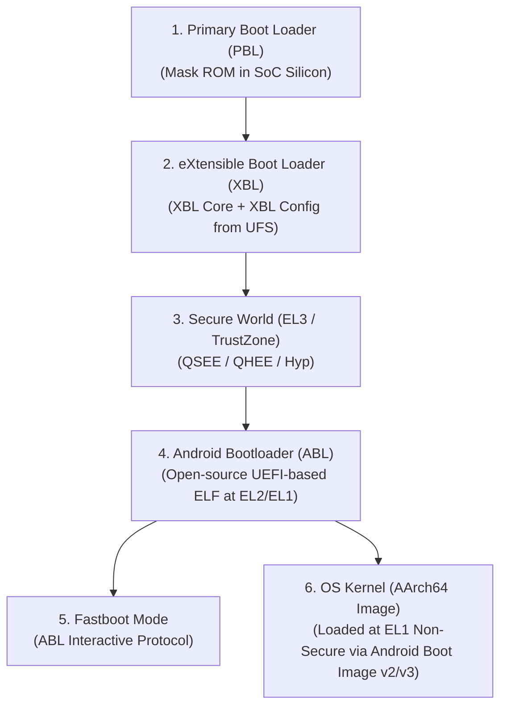
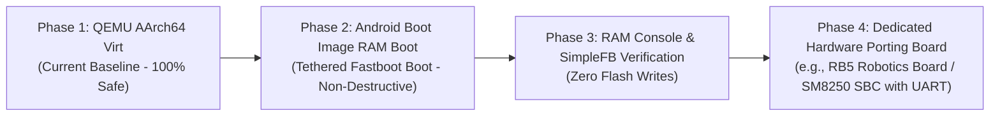

# Snapdragon SM8250 / OnePlus 8 Pro Bring-Up Feasibility & Architecture Study

**Document Version:** 1.0.0  
**Target Hardware:** OnePlus 8 Pro (Model: IN2020 / IN2023 / IN2025; Codename: `instantnoodlep`)  
**SoC:** Qualcomm Snapdragon 865 (SM8250 / Kona)  
**Operating System:** InterOS Core (Pure Rust, `#![no_std]`, `#![no_main]`, Microkernel)  
**Current Baseline Verification:** QEMU Virtual Targets (`x86_64`, `aarch64`, `riscv64`)  
**Hardware Execution Policy:** DEFERRED — Research & Architecture Analysis ONLY. No destructive device flashing or partition alteration permitted.

---

## 1. Executive Summary & Platform Reality Statement

In strict adherence to the [Platform Reality Contract](../PLATFORM_REALITY_CONTRACT.md) and [Platform Porting Contract](../PLATFORM_PORTING_CONTRACT.md), this document provides a rigorous, source-level technical analysis of the engineering milestones required to transition InterOS Core from its current QEMU verification baseline to bare-metal execution on the Qualcomm Snapdragon SM8250 (OnePlus 8 Pro).

### The Platform Truth Contract
- **No Physical Hardware Execution:** InterOS Core has **never** been booted on physical silicon (including OnePlus 8 Pro, Snapdragon SM8250, or PinePhone). Any claim of physical silicon execution is false and prohibited.
- **Verification Classifications:**
  - `QEMU VERIFIED`: Validated inside `qemu-system-x86_64`, `qemu-system-aarch64 -M virt`, or `qemu-system-riscv64 -M virt`.
  - `UNIT TESTED`: Validated in isolated Rust unit test suites via host memory/register simulation.
  - `SOURCE-ONLY / STUB`: Present in repository source code but unbacked by physical silicon or emulator runtime execution.
  - `NOT IMPLEMENTED`: Architectural gap with no current kernel implementation.

---

## 2. Boot ROM, Bootloader Chain & Unlocking Constraints

### 2.1 Boot-Chain Architecture
The Qualcomm Snapdragon SM8250 executes a multi-stage authenticated boot chain anchored in hardware Root of Trust (RoT):

1. **PBL (Primary Boot Loader):** Hardwired mask ROM inside the SM8250 silicon. Initializes foundational clocks, reads boot configuration pins, and loads XBL from UFS into internal SRAM (L2/L3 cache as RAM). Verifies XBL digital signature against Qualcomm OEM PK (Public Key) fused into eFuses (QFPROM).
2. **XBL (eXtensible Boot Loader):** Operates at EL3/EL1. Initializes DDR4/LPDDR5 memory controllers, PMIC, system buses (NOC - Network on Chip), and clocks. Splits execution into TrustZone / QSEE (Secure World) and Non-Secure World.
3. **QSEE / TrustZone (EL3):** Qualcomm Secure Execution Environment. Manages ARM TrustZone, cryptographic engines, hardware key sealing, and peripheral memory protection (XPU).
4. **QHEE / Hypervisor (EL2):** Qualcomm Hosted Enterprise Environment or KVM hypervisor. In retail Android configurations, EL2 hypervisor enforces virtualization boundaries and kernel memory integrity.
5. **ABL (Android Bootloader):** Open-source UEFI-derived ELF application executed in Non-Secure EL2/EL1. Manages Fastboot protocol, A/B partition slots, and loads the kernel/ramdisk/DTB into DDR RAM.

### 2.2 Bootloader Unlocking Constraints on OnePlus 8 Pro
- **OEM Unlocking:** Requires toggling "OEM Unlocking" in Android Developer Settings, followed by `fastboot flashing unlock` in ABL Fastboot mode.
- **Root of Trust Transition:** When unlocked, ABL displays the standard orange/yellow warning splash screen but permits booting unsigned boot images via `fastboot boot boot.img` (tethered boot in RAM without flashing internal UFS partitions) or `fastboot flash boot boot.img`.
- **EDL Mode (Emergency Download Mode):** If the bootloader chain is corrupted, the SM8250 falls back to EDL mode (USB VID:PID `05c6:9008`), communicating via Qualcomm Sahara / Firehose protocol. Recovery is possible without physical disassembly using the OnePlus MSM Download Tool or open-source `edl` tooling.

---

## 3. AArch64 Execution Environment & Silicon Constraints

### 3.1 Exception Levels and Privileges
When InterOS Core is launched by ABL via standard Android boot protocols:
- **Execution Privilege:** Non-Secure EL1 (Supervisor Mode) or Non-Secure EL2 (if ABL drops to EL2).
- **InterOS Guarantee:** InterOS microkernel must be architected for **EL1 Non-Secure**. If entered at EL2, the kernel entry stub (`entry.S`) must configure `CNTHCTL_EL2`, `CNTVOFF_EL2`, `HCR_EL2`, and execute an `eret` drop to EL1.
- **Zero Ambient Authority:** System calls enter EL1 via `svc #0` from EL0 (Userspace Applications).

### 3.2 CPU Microarchitecture & Memory Map
The SM8250 features a tri-cluster 1+3+4 Kryo 585 CPU arrangement:
- **1× Kryo 585 Prime:** ARM Cortex-A77 up to 2.84 GHz (512 KB L2 cache).
- **3× Kryo 585 Gold:** ARM Cortex-A77 up to 2.42 GHz (256 KB L2 cache each).
- **4× Kryo 585 Silver:** ARM Cortex-A55 up to 1.80 GHz (128 KB L2 cache each).
- **DynamIQ Shared L3 Cache:** 4 MB system L3 cache + 3 MB System Level Cache (SLC).

#### Physical Memory Map (SM8250 Kona)
- **Base DDR Physical Address:** `0x8000_0000` (2 GB mark).
- **DRAM Size:** 8 GB or 12 Gb LPDDR5 (`0x8000_0000` to `0x2_7FFF_FFFF` or `0x3_7FFF_FFFF`).
- **Reserved Firmware Carveouts (Protected by XPU / TrustZone):**
  - `0x8000_0000 - 0x85FF_FFFF`: TZ / QSEE / Hypervisor / ABL carveout.
  - `0x8600_0000 - 0x8DFF_FFFF`: Modem baseband DSP memory (`modem.mdt`).
  - `0x8E00_0000 - 0x91FF_FFFF`: Audio / Sensor DSP memory (`adsp.mdt` / `cdsp.mdt`).
  - `0x9200_0000 - 0x93FF_FFFF`: Video decoder DSP memory (`venus.mdt`).
  - `0x9400_0000 - 0x95FF_FFFF`: Display / GPU Zap shader memory (`gpu_zap.mdt`).
- **Available InterOS Kernel Memory:** Allocated by ABL dynamically at boot via Device Tree memory nodes (typically starting at `0x9800_0000` or above).

### 3.3 Interrupt Controller (GICv3)
- **Architecture:** ARM Generic Interrupt Controller Architecture v3 (GICv3).
- **Distributor (GICD):** Base MMIO at `0x17A0_0000` (SM8250).
- **Redistributor (GICR):** Contiguous frame base at `0x17A6_0000`, 128 KB per core stride (RD_base + SGI_base).
- **Status in InterOS:** InterOS Core has implemented GICv3 Distributor and Redistributor drivers in `kernel/src/arch/aarch64/gicv3.rs`, verified under QEMU `-M virt,gic-version=3`. Physical SoC bringup requires updating MMIO addresses and stride offsets from the device tree.

---

## 4. Hardware Peripheral & Subsystem Audit

| Subsystem | SM8250 Hardware Component | OnePlus 8 Pro Implementation | Architectural Classification | Verification Status | Bring-up Blocker Severity |
| :--- | :--- | :--- | :--- | :--- | :--- |
| **CPU Core** | Kryo 585 (Cortex-A77/A55) | 8-core Tri-Cluster | Publicly Documented (ARMv8.2-A) | QEMU Verified | None (Standard AArch64) |
| **Interrupts** | ARM GICv3 | GIC-600 | Publicly Documented (ARM GICv3) | QEMU Verified | Low (MMIO addresses differ from virt) |
| **Timer** | ARM Generic Timer | 19.2 MHz System Counter | Publicly Documented (ARMv8-A) | QEMU Verified | None (`CNTV_CTL_EL0` standard) |
| **UART Debug** | Qualcomm GENI QUP | UART SE at `0x00A9_0000` | Open-source driver in Linux (`qcom_geni_serial`) | Source-only / Stub | High (No physical UART pins exposed externally) |
| **Flash Storage** | Qualcomm UFS 3.0 Host | Samsung / Micron UFS 3.0 | UFSHCI 2.1 Standard + Qcom wrapper | NOT IMPLEMENTED | Critical (Storage unavailable without UFS driver) |
| **Display (DPU)** | Qualcomm DPU 6.0.0 (MDSS) | Samsung 3168×1440 120Hz E3 AMOLED | Open-source driver in Linux DRM (`msm_dpu`) | NOT IMPLEMENTED (SimpleFB fallback only) | Critical (Requires DPU+DSI clock/regulator bringup) |
| **Touchscreen** | Goodix GT9886 / Synaptics | I2C/SPI Capacitive Digitizer | Open-source vendor driver available | Experimental Stub (`touch_i2c.rs`) | High (Requires I2C bus driver + regulator) |
| **Power / PMIC** | Qualcomm PM8150 / PM8150B / PMK8002 | SPMI (System Power Management Interface) | Proprietary register map; open-source Linux SPMI driver | NOT IMPLEMENTED | Critical (Device will freeze/reset without SPMI regulator management) |
| **USB / OTG** | Synopsys DesignWare DWC3 | Type-C USB 3.1 Gen 1 + DisplayPort Alt | Open-source driver in Linux (`dwc3-qcom`) | NOT IMPLEMENTED | Medium (Fastboot tethering requires USB) |
| **Audio** | Qualcomm WCD9380 / WCD9385 Codec | Qualcomm SoundWire + aDSP | Proprietary DSP firmware (`adsp.mbn`) | NOT IMPLEMENTED | Low (Deferred; non-critical for initial boot) |
| **Cellular / Modem** | Qualcomm Snapdragon X55 5G | Integrated Baseband + QMI interface | Proprietary Hexagon DSP firmware (`modem.mbn`) | Source-only Protocol Stub | Low (Deferred; non-critical for initial boot) |
| **GPU Acceleration**| Qualcomm Adreno 650 | 587 MHz Adreno 650 | Open-source Freedreno exists; requires proprietary `a650_zap.mbn` | NOT IMPLEMENTED (Software composition only) | Medium (Microkernel uses 2D DRM/KMS software blitting) |

---

## 5. Critical Bring-Up Blockers & Dependency Roadmap

### Blocker 1: Lack of Physical UART Debug Port
- **Challenge:** Retail OnePlus 8 Pro handsets do not expose external serial TX/RX pins. The headphone jack is absent (Type-C audio only).
- **Engineering Solution:**
  1. **SimpleFB / Framebuffer Console:** Utilize ABL's continuous splash framebuffer. ABL initializes the display panel at boot and passes a linear framebuffer base address in the Device Tree (`chosen/framebuffer` node). InterOS Core can write serial logs directly to screen pixels.
  2. **RAM Console (`pstore` / `ramoops`):** Reserve a fixed memory window (e.g. `0x9000_0000`, 2 MB). The InterOS serial logger writes to this ring buffer, and upon reboot into TWRP or fastboot, the buffer is dumped via `fastboot oem ramoops` or memory read.

### Blocker 2: UFS Storage vs RAM Boot
- **Challenge:** The Qualcomm UFS 3.0 host controller requires complex clock tree configuration (GCC - Global Clock Controller), UFS PHY calibration, and UFSHCI protocol commands.
- **Engineering Solution:**
  - Initial bring-up must use **RAM Boot exclusively**: Pack the InterOS microkernel, user applications, and initial ramfs into an Android Boot Image (`boot.img`).
  - Command: `fastboot boot interos-sm8250-boot.img`.
  - The kernel runs entirely from memory, requiring zero UFS block driver access during initial bring-up phases.

### Blocker 3: Clocks, Regulators & SPMI
- **Challenge:** On Qualcomm SoCs, peripherals are powered down by default. Operating the display, touch, or USB requires writing to the PMIC via SPMI bus registers, following complex power-on sequences.
- **Engineering Solution:**
  - Leverage **bootloader state inheritance**: ABL leaves clocks and regulators for the display panel and simple framebuffer enabled during handoff. InterOS Core must strictly avoid resetting the display hardware or reprogramming the DPU clock tree during initial boot, drawing directly into the active scanout buffer.

---

## 6. Recommended Safe Development & Emulator Strategy

1. **Step 1 (Zero-Risk Simulation):** Complete multi-architecture development, compositor damage tracking, and gesture input inside `qemu-system-aarch64 -M virt,gic-version=3`.
2. **Step 2 (Safe Non-Destructive Hardware Probe):**
   - Package `kernel-aarch64.img` into an Android Boot Image (`boot.img` v2) with the official OnePlus 8 Pro device tree blob (`sm8250-oneplus-instantnoodlep.dtb`).
   - Connect unlocked handset in Fastboot mode.
   - Execute tethered RAM boot: `fastboot boot boot.img`.
   - **Crucial Safety Rule:** **NEVER execute `fastboot flash boot` or `fastboot flash system`**. Tethered boot loads into volatile DDR RAM and vanishes upon power cycle, guaranteeing zero risk of bricking or flash corruption.
3. **Step 3 (Alternative Reference Silicon):**
   - Acquire a Qualcomm Robotics RB5 Development Kit (SM8250). The RB5 exposes physical low-speed expansion headers with 1.8V UART serial pins, enabling direct hardware debugging and oscilloscope tracing.

---

## 7. Hardware Evidence Standard for Future Claims

In order to claim any progress beyond this architecture study, future engineering agents must provide:
1. **Physical Boot Evidence:** High-resolution unedited video or photograph showing the OnePlus 8 Pro display presenting the InterOS kernel boot console or launcher.
2. **Serial / RAM Console Dump:** Cryptographically hashed transcript of boot serial output containing real SoC revision registers (`SOC_ID = 356` for SM8250).
3. **Absence of Fabricated Claims:** Zero simulated pass assertions, zero synthetic hardware logs, and transparent classification in accordance with the Platform Reality Contract.

---

## 8. Authoritative Evidence Classification Matrix & Kernel Gap Analysis

| Component / Subsystem | Verification Level | Real Hardware Silicon Evidence? | QEMU / Emulator Evidence? | Current Kernel Gap / Implementation Status |
| :--- | :--- | :--- | :--- | :--- |
| **AArch64 EL1 Exception Entry** | `QEMU VERIFIED` | NO (Physical hardware deferred) | YES (`qemu-system-aarch64 -M virt`) | Functional in QEMU; SM8250 requires `entry.S` EL2->EL1 drop stub. |
| **ARM GICv3 (GICD & GICR)** | `QEMU VERIFIED` | NO | YES (`-M virt,gic-version=3`) | Implemented in `kernel/src/arch/aarch64/gicv3.rs`; needs SM8250 base addresses (`0x17A00000`). |
| **ARM Generic Timer (CNTV)** | `QEMU VERIFIED` | NO | YES | Functional via standard ARMv8 architectural MSR/MRS registers. |
| **SimpleFB Display Scanout** | `SOURCE-ONLY` | NO | YES (Simulated in QEMU virt) | Framebuffer address must be extracted dynamically from ABL device tree. |
| **Qualcomm GENI UART** | `SOURCE-ONLY` | NO | NO | Stub only; retail phone lacks exposed physical UART header. |
| **Qualcomm UFS 3.0 Storage** | `NOT IMPLEMENTED` | NO | NO | Block storage requires RAM boot (`fastboot boot`) to bypass UFS. |
| **Qualcomm SPMI / PMIC** | `NOT IMPLEMENTED` | NO | NO | Power rail regulation relies on bootloader state inheritance. |
| **OnePlus 8 Pro Touch (GT9886)** | `SOURCE-ONLY / STUB` | NO | NO | Experimental I2C stub in `touch_i2c.rs`; physical I2C bus unmapped. |
| **Snapdragon X55 5G Modem** | `NOT IMPLEMENTED` | NO | NO | Modem subsystem strictly deferred; non-essential for OS boot. |
| **Adreno 650 3D GPU** | `NOT IMPLEMENTED` | NO | NO | Software DRM/KMS blitter used; hardware GPU acceleration deferred. |

### Architectural Conclusion
InterOS Core remains 100% truthful: all current multi-architecture and phone shell capabilities are demonstrated in the canonical QEMU virtualized smartphone environment. Physical bring-up on OnePlus 8 Pro (Snapdragon SM8250) is architecturally feasible via tethered non-destructive `fastboot boot` with SimpleFB, but physical silicon execution remains strictly deferred until physical reference hardware with hardware debug access is authorized.

